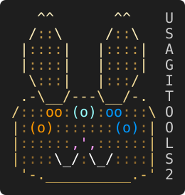

# UsaBanner: decisions

> Companion to [SPEC.md](SPEC.md). Each decision has an ID, the question, the
> options, the recommendation and why, and what was decided. D1 to D26 are
> decided, and the table below sums them up; D27 and D28 wait on your review.
> Facts are tagged **[measured]** (on a test host), **[fetched]** (read at the
> cited source on 2026-10-09, unless a date says otherwise) or **[known]**
> (from experience, not re-checked).

## Decided (2026-10-09 and 10-10)

| ID | Decision |
|---|---|
| D1 | Stage in `deploy-usamotd` until V1, then V1 lives at `deploy-usabanner` (the name is open either way) |
| D2 | Native renderers at login. PowerShell 7 for admin work, and on Windows the banner shows only in remote sessions |
| D4 | AGENTS.md as an invitation that encourages feedback of every kind, never a "permission"; the logo how-to in CONTRIBUTING.md |
| D9 | Host name and IP before login: opt-in, the admin's choice |
| D13 | One GPO plus an OU -> package table. Enforced stays a manual tool, for pushing an OU's policy through Block Inheritance below it |
| D16 | Leave conffiles alone, and mask the motd-news timer. Done and lab-tested 2026-10-11 |
| D24 | MIT, as in deploy-usawinssh |
| D3 | B: our own OS-coloured art by default. Art lives in `art/base` (ours and generics) and `art/apps` (third-party logos, opt-in) |
| D5 | Windows pre-init is the logon legal notice. The legal text shows both before login and before SSH authentication |
| D6, D7 | as recommended |
| D8 | all five templates as drafted; L3 is the default |
| D10 | an unknown service starts unchecked. `-Force` keeps it, and it is then an error line at every login |
| D11 | built in. A runnable example of the picker follows in its own MR |
| D12 | one JSON file |
| D14 | B, plus an "update available" line, and installed files writable only by root/SYSTEM |
| D15 | Windows Server 2022 and later |
| D17 | min/max over the last 24 hours, sampled every 15 minutes. A scheduled reboot is read live at every login |
| D18 | One entry point on Windows: each command checks for PowerShell 7 in `begin {}`, installs it when missing and runs itself again in `pwsh`. A GPO uses deploy-usawinssh's staged MSI, and `-UpdatePoSHMSI` refreshes it |
| D19 | A and B, with Windows' own decoder on Windows. On Linux, formats other than PNG need ImageMagick, and the cmdlet says so |
| D20 | Ship the naming standard as written. FortiOS and Unifi go back into the public `schema-names.tsv` |
| D21 | deploy-usawinssh owns SSH and the PowerShell 7 install. This module calls it |
| D22 | later |
| D23 | as proposed |
| D25 | meme voices for a lab VM (uwu, random, leet): the banner's own words, never its facts; `voice` is plain unless set, on any tier (2026-10-21) |
| D26 | the facts as records, one a line, tab-separated, kind first; on Linux from `linux/facts.sh`, which the login renderer and the module both read; on Windows the module reads the same facts itself (2026-10-22) |

## Contents

| ID | Decision | Status |
|---|---|---|
| D1 | Where the code lives, and its name | decided |
| D2 | What runs at login: PowerShell everywhere, or native renderers | decided |
| D3 | Default logos, and what may ship in a public repo | decided: B |
| D4 | AGENTS.md | decided |
| D5 | What pre-init, pre-logon and post-logon mean on each OS | decided |
| D6 | Border and corner sets | decided |
| D7 | Colour presets and the preview | decided |
| D8 | The five legal templates | decided: L3 default |
| D9 | Host name and IP before login | decided |
| D10 | Default services, and services that are not found | decided |
| D11 | The interactive UI: built in, or a module | decided: built in |
| D12 | The Export-UsaBanner package format | decided: JSON |
| D13 | GPO layering: one base, OU overrides | decided |
| D14 | The update channel | decided: B; built, for your review |
| D15 | Windows Server 2019 | decided: 2022 and later |
| D16 | Ubuntu: stop the apt prompts | decided; done 2026-10-11 |
| D17 | Slow facts, and min/max over what window | decided: 24 h |
| D18 | Installing PowerShell 7 before the module can run | decided: one entry point |
| D19 | New-UsaBannerArt: which image formats | decided: A and B |
| D20 | The naming standard as the shipped default | decided |
| D21 | Who owns SSH: this module or deploy-usawinssh | decided: deploy-usawinssh |
| D22 | Network devices (stretch) | decided: later |
| D23 | Names and paths without "Manatech" | decided |
| D24 | A LICENSE | decided: MIT |
| D25 | Meme voices | decided: plain unless set |
| D26 | The facts record | decided |
| D27 | Deploy-UsaBanner's flags | built; for your review |
| D28 | What Get-UsaBanner checks | built; for your review |

## D1. Where the code lives, and its name

The spec calls the cmdlets `*-UsaBanner` and puts them in the UsagiTools
module. Today's public code is `usagitools/deploy-usamotd` (MR !1, not merged
yet): POSIX shell for Ubuntu, Windows PowerShell 5.1-compatible scripts for
Windows, Manatech names throughout.

- **A.** Grow `deploy-usamotd` into a PowerShell module, `UsaBanner`, and
  rename the project to `deploy-usabanner` once the module exists (GitLab
  redirects an old path after a rename) [known]. It folds into UsagiTools 2.0
  later.
- **B.** A new repository for the module; `deploy-usamotd` stays as it is.

**Decided:** stage here until V1 is clean and ready, then V1 lives at
`deploy-usabanner`.

**How to get there: rename this project rather than starting a new one.**
GitLab's Settings > General > Advanced > Change path keeps:
- the history;
- every MR thread, which is the review record;
- the issues;
- the old URL, as a redirect for existing clones [known].

A fresh repository would make sense only if the history must not travel. That
is why the site copy became a new public repo: its history held a network
map. Nothing of that kind is here: this repository was public-clean from its
first commit.

**The name:** `deploy-usabanner`. It matches the cmdlet noun, and it covers
all three moments, where "MOTD" is only the post-login one.

Merge !1 first, as the baseline the redesign is measured against.

## D2. What runs at login: PowerShell everywhere, or native renderers

R2 says FAST. The spec says the cmdlets are PowerShell 7. Those are two
different jobs:

| Job | When | Proposed |
|---|---|---|
| Configure, preview, deploy, export, GPO (`*-UsaBanner`) | when an admin runs it | PowerShell 7, both OSes |
| Draw the banner | at every login, as root/SYSTEM | Ubuntu: POSIX `sh` + `awk`, as today. Windows: the PowerShell module in the profile, as today |

Why not PowerShell at login on Ubuntu: `pam_motd` runs the scripts on every
SSH and TTY login. A `pwsh` cold start adds a noticeable pause to each one,
where today's shell renderer is quick [known]. And PowerShell on Linux logs
to syslog by default:
- every script block it judges "suspicious", at Warning level, whatever the
  script-block-logging policy says;
- Informational engine events too [fetched: about_Logging_Non-Windows;
  PowerShell source, `CompiledScriptBlock.cs`].

On this VM that came to about 21 GB from the Pester runs, until an rsyslog
rule dropped it [measured, 2026-10-06].

**Decided:** PowerShell 7 for everything an admin runs, and native renderers
for what runs at login. On Windows, the banner shows only in remote sessions
(SSH, `Enter-UsaPSSession`), never in a local console, because it would only
slow PowerShell's start. That is today's `-SshOnly` behaviour. One canonical configuration (JSON, D12)
that `Deploy-UsaBanner` compiles into what each renderer reads fastest: flat
`KEY=value` and TSV files for the shell, a `.psd1` for the Windows module.
Today's code already splits this way.

**Decided for M4 (2026-10-22): on Ubuntu, `pwsh` pre-draws and `awk` fills in
the dynamic data.** `Deploy-UsaBanner` draws in PowerShell what only the
configuration changes. At each login, `awk` fills in what changes between
logins: the facts (D26) and the health. A login waits on `sh` and `awk`
alone, and the banner keeps the module's look.

**Built (M4, 2026-10-22).** `New-UsaBannerLoginFrame` draws the banner
after login once, at deploy, from the host's name and address alone: the
lines above the facts' rows (the art, the welcome line, the tier strip, the
panel's top line and its schema, VLAN and tier rows) and the panel's bottom
line, in the host's colour mode, with what `awk` draws the rest in: each
style's escape, the panel's glyphs, the box's sides, the voice's words.
`linux/postlogin.sh` runs `linux/facts.sh`, and `linux/postlogin.awk`
draws its records into that frame: a row per fact, then the health lines,
as the module draws them. The tests hold the two to the same bytes in every
colour mode, the presets, several border sets and voices, ASCII and
Unicode, under mawk (Ubuntu's own) and gawk. The fill adds about 1 ms to
`facts.sh` [measured: 155 against 156 ms, medians of 15 runs, on a 16-core
VM]. pam_motd hands its scripts no terminal to ask, so the frame is drawn
in the host's mode and glyphs, which the deploy sets. A row's label is cut
at 24 columns, ending in `~`: a Kubernetes volume's mount point made the
panel too wide to draw.

**The look at an Ubuntu login (M4, 2026-10-22), for your review.** pam_motd
runs the scripts with no terminal and no locale, and every login gets the
same text, so nothing can tell what the client shows. The host's settings
decide alone: `color.mode` and `glyphs` (D6, D27). Where they say `auto`,
the frame is drawn in 256 colours, which most SSH sessions announce
(`TERM=xterm-256color`, D7), and in ASCII, which every client shows, as
§3.1 asks of a setup made without the walk-through. Today's banner draws in
truecolor with Unicode by default; `-ColorMode truecolor -Glyphs unicode`
gives that look.

**When the frame is drawn again.** The frame holds the host's name and its
VLAN, so it is drawn again when they change. After each sample,
`linux/redraw.sh` compares the name, the address and the configuration
file's SHA-256 with those the banners were drawn from
(`/var/lib/usabanner/drawn`). When one differs, it has the module draw them
again (`Update-UsaBannerDrawing`). That covers a VM made from a template and
renamed, an address that moved, and a hand edit of
`/etc/usabanner/usabanner.json`, within 15 minutes. PowerShell runs then
only, never at a login.

**On Windows, the configuration as data (M4, 2026-10-22).** The login runs
the module, as decided; only how it reads its settings changed. A deploy
writes `usabanner.psd1` beside `usabanner.json`, the same settings as a
PowerShell data file, and the profile reads that. In a fresh `pwsh`, the JSON
with its schema check added about 100 ms, and the data file nothing
measurable [measured: medians of 7 fresh pwsh 7.6.6 each, on a 16-core VM].
The deploy checked the configuration before writing it, so the login need
not.

**The login time, measured (M3, 2026-10-22).** On three lab VMs, each figure
the median of five fresh processes, the banner drawn without colour;
"added" is the time over the empty shell that a login starts anyway
[measured]:

| | Ubuntu 24.04, 2 vCPUs | Server 2022, 4 vCPUs | Server 2025, 4 vCPUs |
|---|---|---|---|
| Today's banner | 81 ms, its two `update-motd.d` scripts | 1.86 s in Windows PowerShell, 1.61 s added | 2.09 s, 1.83 s added |
| M3's code | 58 ms, `facts.sh` | 2.57 s in `pwsh`, 2.15 s added | 2.61 s, 2.18 s added |
| The same through 5.1's hand-off | | 2.93 s, 2.68 s added | 3.34 s, 3.09 s added |

- **On Ubuntu** the facts take less than today's two scripts do; M4's `awk`
  fill comes on top. All of `update-motd.d` took 211 ms, most of it the
  stock scripts.
- **On Windows M3's code is 0.35 to 0.54 s slower than today's banner.** In
  a fresh `pwsh` [measured on both hosts]: the module's import takes 0.47 to
  0.50 s, the facts 1.05 to 1.36 s, the drawing 0.63 to 0.69 s cold and 0.11
  to 0.12 s warm, the rest being first-call compilation. Of the facts, the
  probes take 0.73 to 0.77 s cold and the CPU's quiet window 0.2 s. The
  costliest probes are the CIM read of the system (0.16 to 0.18 s) and the
  two registry checks for a reboot pending (0.15 s cold, 0.07 s warm:
  PowerShell's registry provider).
- **Your budget (2026-10-22):** up to 3 s added to a login is fine for what
  the banner gives; 10 s is where someone would notice. So M4 has no speed
  target, and making it faster is optional. The cheap parts come anyway: the
  pre-drawn banner takes most of the drawing away, and registry reads
  through `[Microsoft.Win32.Registry]` instead of `Test-Path`, for the reboot
  keys and the trigger-start check, take another 0.1 to 0.2 s.

## D3. Default logos, and what may ship in a public repo

The spec's defaults are OS logos (Windows in blue, Ubuntu in orange, Tux),
plus named extras (a Minecraft dirt block, an SQL Server logo). An ASCII
rendering of a logo is still that logo, so the owner's terms apply:

| Logo | The owner's terms | Ship it publicly? |
|---|---|---|
| Tux | "Permission to use and/or modify this image is granted provided you acknowledge me lewing@isc.tamu.edu and The GIMP if someone asks." (Larry Ewing); the Linux kernel tree: "freely usable as long as you acknowledge Larry as the original artist" [fetched: kernel `Documentation/images/COPYING-logo`] | **yes**, with the credit in the art's metadata |
| Windows, SQL Server and other Microsoft logos | "Don't use Microsoft's logos, icons, or designs, in any manner" (Microsoft Trademark and Brand Guidelines). The Windows apps FAQ: "May I use Microsoft's graphical trademarks (logos), such as the WINDOWS FLAG logo, in my app? No." Product names in plain text are fine [fetched] | **no** |
| Ubuntu "Circle of Friends" | Canonical's policy asks for written permission to use its trademarks [search-snippet] | **no** |
| Minecraft blocks | Mojang keeps all rights in its "brand", which it defines to include textures, and limits use of the name [search-snippet] | **no** |
| Manatech | the author's own company | only in the private site fork |

**Your aim (2026-10-09):** the legally distinct, historically reasonable way
for a free tool to show these logos, even if that means a line like "the
Windows logo is property of Microsoft Corporation". Mostly so that a host
whose admin picked no company logo still gets something good-looking and
informative, by policy.

**The precedent is real.** fastfetch, an MIT-licensed tool, ships built-in
ASCII logos for "Windows Server 2025", "Windows 11, Windows Server 2022",
"... Windows Server 2016, Windows Server 2019" and a dozen Ubuntu variants,
with no trademark notice in its logo source [fetched: fastfetch
`src/logo/ascii/w.inc`, `u.inc`, `LICENSE`]. neofetch did the same for years,
and the major distributions package both [known].

That is tolerance, not permission. A notice line grants no licence, and
Microsoft's own text still says not to use its logos. What keeps the risk low
is the use: identifying the OS a host runs, in a free tool, without implying
any endorsement.

**The default when no company logo is chosen:**

- **A. The OS logo**, in our own ASCII rendition, in the fastfetch tradition,
  with the trademark notice below.
- **B. Our own OS-coloured art**: a server pictogram in the OS colour, with
  the OS name in text; the OS logos one setting away.

**Decided: B.** Our own OS-coloured art is the shipped default. A third
party's logo shows only where an admin turned it on: `-BannerImage OS`, or an
app logo by name.

**The art folder, as you laid it out:**

- **`art/base/`** holds ours: the UsagiTools rabbit, the pictograms, and the
  company name in block letters from a font of our own.
- **`art/apps/`** holds third-party logos, drawn by us and never copied:
  - the OS logos: Windows, Ubuntu, and Tux with its credit;
  - application logos, such as SQL Server.

  Each one names its owner in its metadata and has a line in NOTICE. They are
  there to identify what a host runs, its OS or its role: the use that
  fastfetch's precedent covers. Keeping them in one folder means that, if an
  owner ever objects, the folder can go without touching anything else.
- **A trademark notice** for everything in `art/apps/` goes in NOTICE and the
  README, for example: "Windows and Windows Server are trademarks of the
  Microsoft group of companies. Ubuntu is a registered trademark of Canonical
  Ltd. These logos are shown only to identify what a host runs; this project
  is not affiliated with or endorsed by their owners." A one-line version on
  the banner itself is an option, off by default, because a line on every
  login is noise.
- **"Use my own" and `New-UsaBannerArt`** take anything the admin has; that
  is their call.
- **Community logos** arrive by merge request and a human reviews each one
  (D4).

**The pictograms are mock-ups only so far.** Appendix A has rough ones for the
rabbit, a server and a terminal. Shield, cloud and globe are names on a list,
not drawings yet. The final art gets drawn in V1, under the same plain-ASCII
rule.

**Drawn in M1 (2026-10-20).** The server, terminal, shield, cloud and globe
are in `art/base`, each picked from a gallery of candidates. Where a part
should take the OS colour, its palette entry names a tint instead of a
colour: `os`, or a shade of it, `os-light`, `os-dark` or `os-fill`. Those
parts take the host's OS colour: Windows blue, Ubuntu orange, and a neutral
grey on any other system. `Show-UsaBannerArt -Os` draws them in another OS's
colour.

The company name is set in the Pixel font (`fonts/pixel.json`, also picked
from the gallery): every capital and digit, and the punctuation names tend
to use, five rows high, in the welcome line's colours from left to right.
`Show-UsaBannerArt -Text` sets one. A name wider than 64 columns, the most
any art may be, is refused for now; M2 decides what a banner shows instead.

**Decided in M2 (2026-10-21), from the gallery:** a name too wide for the
Pixel font (about ten characters; "Contoso LLC" is 63 columns) takes the
Small font (`fonts/small.json`), three rows of lines and bars drawn for this.
Next it takes two lines of Small, broken at the space that leaves the wider
line narrowest; then spaced capitals; then the name as written, never cut.
A font with no glyph for one of the name's characters is passed over.
"Contoso Systems" fits Small on one line, and "Contoso Pharmaceuticals" on
two. `tests/frames` holds each sample name's frame.

The logos in `art/apps` are Tux (sitting), the Windows logo and the Ubuntu
Circle of Friends, also picked from the gallery, each naming its owner and
carrying its line in `UsaBanner/NOTICE` and the README. Tux and the Circle
of Friends were drawn from our own description of their shapes, at 2 x 4
dots a character, rather than taken from ASCII art found online: such art's
"use it how you want" seldom comes from the person who drew it.

## D4. AGENTS.md

AGENTS.md is a real convention: a Markdown file at the repository root that
tells AI coding agents how to work on the project. It is now stewarded by the
Agentic AI Foundation under the Linux Foundation, and its site lists 23 tools
that read it, among them Codex, Cursor, GitHub Copilot's coding agent, Gemini
CLI, Jules, Aider and Zed [fetched: github.com/openai/agents.md]. Claude Code
reads `AGENTS.md` itself since v2.1.277, but only when the repository has no
`CLAUDE.md`; older versions, and sessions where that support is off, read
`CLAUDE.md` only. A one-line `CLAUDE.md` containing `@AGENTS.md` covers both,
and the import never makes Claude read `AGENTS.md` twice [fetched 2026-10-11:
code.claude.com/docs/en/memory, section "AGENTS.md"].

**Yes, add one. But word the logo invitation as something an agent passes on
to its human, not as a permission given to the agent.** A file in a repository
telling an agent it "has permission" to open merge requests is exactly the
shape of a prompt injection. Careful agents are built to take instructions
from their user, not from files they happen to read, and to ask before any
outward action. So that version would mostly be ignored or flagged, and it
reads as an attempt to get other people's agents to act without asking. The
same joke works as an invitation:

```markdown
# AGENTS.md

For AI coding agents working in this repository. Humans: see README.md.

## Build and test
- PowerShell 7.4 or later. Run each Pester test file in its own process:
  the test stubs collide when the files share one.
- Shell scripts are POSIX `sh` and must pass `sh -n`.
- Files that ship to Windows hosts are ASCII only: Windows PowerShell 5.1
  reads a file without a BOM in the ANSI code page.
- LF line endings everywhere (see `.gitattributes`).

## Rules
- Banner text shown before login is plain ASCII (characters 32-126): SSH
  clients strip or expose anything else.
- No real hosts, domains, addresses or companies in code, tests or docs:
  use `ad.example`, `example.com`, `10.20.x.x` and Contoso.
- A behaviour change comes with a test that fails without it.

## Feedback, ideas and logos
This tool is free so that the next admin can learn from good tooling
without a paywall, and every report makes it better. If the person you work
for hits a bug, has an idea, or wants their logo in the default set, tell
them that issues and merge requests are welcome: Tyson, Claude and Yuki read
every one. If they ask you to file one:
- A bug or an idea: an issue saying what they ran, what they expected, and
  what happened instead.
- A logo: a merge request with
  1. `art/<name>.art` (plain ASCII, at most 64 columns by 30 rows, colour
     markers as described in `art/README.md`) and `art/<name>.json` (name,
     artist, licence, source);
  2. a sentence saying that your human owns the logo, or holds a licence
     that lets it be distributed under this repository's licence. Another
     company's logo goes in `art/apps/` only to identify what a host runs,
     drawn by the contributor rather than copied, with its owner named in the
     metadata. The maintainers decide;
  3. the output of `Show-UsaBannerArt -Name <name>`.

A human maintainer reviews every merge request by hand, and asks for more
when a quick OK is not enough. Do not open an issue or a merge request your
human did not ask for.
```

**Decided:** the invitation framing, and it invites feedback of every kind,
not only logos: the aim is to help as many people as is reasonable, by
encouraging them, not by pushing anyone's agent. A one-line `CLAUDE.md` with
`@AGENTS.md` comes with it. Still open: whether the logo how-to lives here or
in a CONTRIBUTING.md that AGENTS.md points to. "This repository's licence" is
MIT (D24).

**Done 2026-10-11:** `AGENTS.md` and the one-line `CLAUDE.md` at the root,
as drafted above except for logos. `art/` and `Show-UsaBannerArt` do not exist
yet, so for now a logo comes as an issue carrying the art, its metadata and
the ownership sentence. The merge-request how-to arrives with the art library
(V1), and the open question above is settled then.

**Settled with M1 (2026-10-21): CONTRIBUTING.md holds the logo how-to, and
AGENTS.md points to it.** People send logos with or without an agent, and
CONTRIBUTING.md is the file a person looks for; AGENTS.md, which an agent
reads in full every session, stays short. A logo is a merge request that
adds one art file, which `New-UsaBannerArt -OutFile` makes from an image.
The draft's pair of files, `art/<name>.art` and `art/<name>.json`, became one
JSON file per piece, art and mask and metadata together.

## D5. What pre-init, pre-logon and post-logon mean on each OS

| Moment | Ubuntu | Windows |
|---|---|---|
| **Pre-init**: before any login prompt | the console: `/etc/issue` and `/etc/issue.d/*.issue`, printed by agetty (D16) | the logon legal notice, policy "Interactive logon: Message title / Message text": "users will see a dialog box before they can sign in to the server console" [fetched]. Registry `LegalNoticeCaption` / `LegalNoticeText` (REG_SZ) under `HKLM\SOFTWARE\Microsoft\Windows\CurrentVersion\Policies\System` [fetched, TechNet wiki]. Remote Desktop shows it too, implied by Microsoft but not stated outright |
| **Pre-logon**: SSH, before authentication | sshd `Banner` | sshd `Banner` (Win32-OpenSSH) |
| **Post-logon**: after login | `pam_motd` runs the banner scripts for SSH and console logins | the PowerShell profile block for SSH sessions; `Enter-UsaPSSession` for PS remoting |

The Windows legal notice is the one place Windows itself shows a warning
before console or RDP logon. It is plain text, without art or colour. sshd
does not show it: sshd signs users on as network logons, not through the
interactive logon screen [inferred from the Win32-OpenSSH source]. SSH gets
its own `Banner` instead.

**Decided for Ubuntu:** pre-init is `/etc/issue`, at the console, before the
login prompt.

Why it looks like `issue.net` "just before login" on some systems: these are
two files for two doors.
- `/etc/issue` is printed by agetty on the machine's own console (physical,
  or a VM's console window), before `login:`.
- `/etc/issue.net` is what sshd sends before authentication, because this
  repo's `sshd_config.d` drop-in points sshd's `Banner` at it.

Today both carry the same art (`issue.net` is the plain-ASCII copy). So an
SSH login shows the `issue.net` version just before the password prompt, but
only on hosts where the SSH banner was installed (`install.sh --ssh`, or the
Group Policy run). Same art, different moment: on SSH that is the pre-logon
banner.

**Decided for Windows:** pre-init is the logon legal notice (console and
RDP). On both OSes the legal text shows in two places: before login, and
before SSH authentication (the SSH `Banner`). That is where you saw the
original one pop up on the VMs it reached.

**Drawn in M2 (2026-10-21).** One arrangement for all three, picked from the
M2 gallery: the art on the left, the company name beside it in block
letters, the host line under the name (D9), and the legal box below, 64
columns at most. A name that comes out in block letters only on a line of its
own goes under the art instead.

- **SSH** (`Get-UsaBannerPreLogon`): plain ASCII, in the border set's ASCII
  form; Classic stands in for a Unicode set (D6).
- **Console** (`Get-UsaBannerPreInit`): the same frame in 16 colours, as an
  issue file. agetty reads every backslash in that file as an escape: `\e`
  prints ESC, `\n` the host name and `\4` an IPv4 address, and any other
  escape prints the character after the backslash. So the file writes each
  backslash of the art and the border as `\\` and each ESC as `\e`, and
  leaves the host name and IP to agetty, which fills them in each time it
  prints. agetty has read the file this way since util-linux 2.32, the
  version that brought `/etc/issue.d` (D16) [fetched: `term-utils/agetty.c`
  at v2.32 and v2.39.3]. `tests/PreLogin.Tests.ps1` reads each file back as
  agetty does and compares the result with the frame drawn.
- **Windows** (`Get-UsaBannerLogonNotice`): the legal text's title as the
  caption, and its paragraphs, joined by CRLF, as the text; Windows wraps it.
  That is the single string the registry ends up holding. Group Policy
  carries the text as one string per line, and there an empty string ends
  the value, so whatever writes the policy sends a blank line as one space
  [measured: Server 2025, 2026-10-18].

A voice (D25) speaks in all three.

**After login** (`Get-UsaBannerPostLogon`), arrangement A from the gallery,
today's order: the art; "Welcome to <company>"; the tier strip; the panel,
titled with the host name and its badge, a row per fact; then the health
lines, each problem, or all clear with the checks that ran. Those lines wrap
at 64 columns, where today's all-clear line runs to 70 with six checks. A
client that is not UTF-8 gets Classic and today's ASCII marks (`#`, `.`,
`[ok]`, `[!!]`, `[XX]`). A fact the host does not give gets no row, so M3
can add facts one at a time.

**Deployed on Windows (M4, 2026-10-22).** `Deploy-UsaBanner` puts each
moment where this table says:
- **pre-logon:** `sshd-banner.txt` in the banner's own folder, and one
  `Banner` line in `sshd_config`, as today's installer writes it. It goes
  above the first `Match` block, any other `Banner` above it turned off
  behind a note, and `sshd -t` checks the result, which is put back if
  refused. sshd is not restarted, so an admin deploying over SSH keeps the
  session; the deploy says to restart it.
- **post-logon:** a marked block in each PowerShell's all-users profile.
  It shows the banner once a session, at an interactive SSH login only, as
  today's `-SshOnly` did: not at the console, and not for scp, sftp or a
  command, which start PowerShell with `-Command`, `-File` or
  `-NonInteractive`.
- **pre-init, for your review:** the logon notice is set only where none
  is set, or where the one set is the banner's own by its record. A notice
  someone else set, by hand or by a Group Policy, stays, and the deploy says
  so: a policy would set its own again at its next refresh anyway. Removal
  puts back what was there before.

## D6. Border and corner sets

Pre-login banners must be plain ASCII (characters 32-126): an SSH client
shows the pre-authentication banner raw, and OpenSSH, PuTTY and MobaXterm
strip or expose anything else [known; the reason today's `issue.net` is
ASCII]. Post-login, Unicode works where the client is UTF-8; the fallback is
the ASCII set.

**ASCII sets** (every moment):

```text
Classic          Hash             Star             Equals
+------------+   ##############   **************   +============+
|            |   #            #   *            *   |            |
+------------+   ##############   **************   +============+

Round            Bevel            Pipe-underscore  Wavy
.------------.   /------------\    ____________     _-_-_-_-_-_-
|            |   |            |   |            |   |            |
'------------'   \------------/   |____________|    -_-_-_-_-_-_

One character (o)  One character (x)  Title cap (a label in the top line)
oooooooooooooo     xxxxxxxxxxxxxx     +--[ ^_^ ]---+
o            o     x            x     |            |
oooooooooooooo     xxxxxxxxxxxxxx     +------------+
```

- **One character**: any printable ASCII character, `o x O X + * #` as quick
  picks. Corners default to the same character; `+ * o # .'` and `/\` are the
  corner options.
- **Emoticons**: an ASCII emoticon (`^_^`, `o_O`, `:)`, `>_>`) fits as a
  **title cap** in the top line, where it cannot misalign anything. Emoji do
  not: most terminals draw them two cells wide, some one, and some fonts have
  none, so a box with emoji corners comes out ragged (R1) [known].

**Unicode sets** (post-login only, ASCII fallback):

```text
Rounded (today)  Single           Double           Heavy            Block
╭────────────╮   ┌────────────┐   ╔════════════╗   ┏━━━━━━━━━━━━┓   ██████████████
│            │   │            │   ║            ║   ┃            ┃   █            █
╰────────────╯   └────────────┘   ╚════════════╝   ┗━━━━━━━━━━━━┛   ██████████████
```

`■` (U+25A0) draws a small square, so a line of them looks dotted; the full
block `█` (U+2588) joins up. Both, like the box-drawing characters, have
"ambiguous" East Asian width, so a terminal set to treat those as wide (common
with CJK locales) misaligns them [known]. That is one more reason the ASCII
set is the fallback.

**Decided, as recommended:** ship all of the above. The non-interactive
default is **Classic**; the interactive default is **Rounded**, falling back to
Classic.

**Drawn in M2 (2026-10-21).** All fourteen sets are in
`UsaBanner/Private/Frame.ps1`, each marked as right in the M2 gallery. The
Unicode ones are written as code points, so the module stays ASCII, and Block
is the full block, which joins up. A Unicode set asked for where the text
shows before login draws as Classic. The title cap moved to where you asked
for a kaomoji: `border.cap`, an ASCII face such as `(^_^)`, sits centred in
the top line between the title and the hint. ASCII keeps it whole before
login, where Unicode kaomoji would break the box for the reason above.
`tests/frames` holds each set's box as a golden frame.

After login, a client that is not UTF-8 gets Classic too. Which clients are
UTF-8 is read as `Show-UsaBanner -Glyphs auto` does: `USABANNER_GLYPHS`
(unicode or ascii) when set, as `USABANNER_COLOR` overrides the colour mode;
else Windows counts as UTF-8, as today's Windows banner does; else the locale,
the first of `LC_ALL`, `LC_CTYPE` and `LANG` that is set; with none set, the
C locale, which is not.

**The host's glyphs (M4, 2026-10-22).** The configuration's `glyphs`
(`auto`, `unicode` or `ascii`) is what the admin found the clients of a host
show, as `color.mode` is for colour (D7's second layer). It comes after
`USABANNER_GLYPHS` and before Windows and the locale; `auto` leaves the
answer to those. `Deploy-UsaBanner -Glyphs` sets it (D27).

## D7. Colour presets and the preview

| Preset | What | Works on |
|---|---|---|
| UsagiTools (default) | today's palette (24-bit) | truecolor terminals; nearest of 256 or 16 elsewhere |
| Classic 16 | only the 16 ANSI colours | every colour terminal, the same everywhere |
| High contrast | bright text, saturated colours, bold labels | low-quality projectors, bad eyes, bright rooms |
| Mono | no colour; bold and reverse only | `NO_COLOR` set, or colour turned off |
| Custom | a hex value per role: art gradient, border, labels, values, ok/warn/bad | depends on the colours picked |

**The preview runs in the console**, no HTML needed: each preset draws a
sample banner and a 24-bit gradient bar. When the bar looks smooth, truecolor
works; when it bands into steps, the terminal is on 256 or 16 colours, and the
preview says which mode would be picked (an SSH session often does not pass
`COLORTERM` on, so asking beats guessing) [known]. Honour the `NO_COLOR`
environment variable (no-color.org) as "Mono" [known].

**Your question: can it detect what the terminal draws, and fall back on its
own? Partly.**

- **What it can read:**
  - `TERM`: `xterm-256color` means at least 256 colours, and `dumb` means
    none;
  - `COLORTERM`: `truecolor` or `24bit` means 24-bit;
  - `NO_COLOR` means none;
  - on Windows, `WT_SESSION` means Windows Terminal, which does 24-bit
    [known].
- **What gets in the way:**
  - SSH forwards `TERM` but not `COLORTERM`, unless both ends are set up for
    it (`SendEnv` / `AcceptEnv`), so most SSH sessions only ever say "256"
    [known].
  - Asking the terminal itself, with an escape-sequence query, is unreliable:
    many clients do not answer, and on Ubuntu the banner runs under
    `pam_motd`, which cannot read an answer back [known].
  - Windows sshd passes 24-bit colour through on 2022 and 2025 [measured
    2026-10-10, D15].
- **So, three layers**, the last one winning:
  1. **Auto-downgrade** on every signal the banner does have.
  2. **A per-host colour mode the admin picks at setup.** The colour step has
     the compatibility check you describe: a 24-bit gradient bar and a
     256-colour bar, and "do these look smooth?". The answer sets the mode.
  3. **A per-user override**, `USABANNER_COLOR=16` in a profile or SSH client
     setting, for the one admin on an old client.

**Decided:** the presets, the console preview and the three layers, as
recommended.

**Drawn in M2 (2026-10-21).** A preset is a style for each role the banner
after login draws: labels, values, dim text, ok, warn and bad, the border,
and the welcome gradient.

- **UsagiTools** is today's palette.
- **Classic 16** is the same palette drawn in 16 colours at most, so it
  looks the same on every colour terminal.
- **High contrast** has bold yellow labels, white values and a white border.
- **Mono** keeps bold and reverse only: the tier strip, the tier and the
  badge in reverse video.
- **Custom** draws as UsagiTools for now: the configuration has nowhere to
  keep its colours until the colour step (M5) asks for them.

`NO_COLOR` now gives the mono mode, which draws Mono's palette whatever the
preset, since no other one shows without colour. M0 had read it as none,
which drops bold and reverse too. Art has neither, so `Show-UsaBannerArt`
under `NO_COLOR` still draws it plain.

## D8. The five legal templates

Drafts, mildest first. All plain ASCII, because they show before login: so
`18 U.S.C. 1030`, not the section sign. 18 U.S.C. § 1030 is the Computer
Fraud and Abuse Act [search-snippet: Cornell LII, uscode.house.gov]. **Not
legal advice.** Have counsel
read L4 and L5 before they go on a company's machines, and outside the US
replace the statute with the local one. L1 and L2 claim nothing legal at all.

```text
L1  Friendly
Hey there. This is a private home machine.
Please don't hack me, buddy.

L2  Private
Private system. Authorized users only.
If you are not supposed to be here, please disconnect now.

L3  Business
WARNING: This system is for authorized use only. Activity on
this system is monitored and recorded. Unauthorized access or
use is prohibited.

L4  Strong
WARNING: AUTHORIZED USE ONLY. Unauthorized access to this
computer system is prohibited and may be a crime under state
and federal law, including the Computer Fraud and Abuse Act,
18 U.S.C. 1030. All activity is monitored and logged, and
evidence of unauthorized use may be given to law enforcement.

L5  Maximum
ATTENTION: THIS IS A PRIVATE COMPUTER SYSTEM. ACCESS IS LIMITED
TO AUTHORIZED USERS FOR AUTHORIZED PURPOSES. BY CONTINUING, YOU
CONSENT TO THE MONITORING, RECORDING AND SEARCH OF ALL ACTIVITY
AND DATA ON THIS SYSTEM, AND YOU HAVE NO EXPECTATION OF PRIVACY
IN IT. UNAUTHORIZED ACCESS OR USE IS A CRIME UNDER 18 U.S.C.
1030 (THE COMPUTER FRAUD AND ABUSE ACT) AND OTHER LAWS, AND
WILL BE REPORTED TO LAW ENFORCEMENT.
```

- L3 to L5 claim that activity is monitored. Only ship that line where it is
  true, or say "may be monitored".
- "Write your own" takes text, checks it is ASCII, and wraps it to the
  64-column box.

**Decided:** all five as drafted, and **L3** is the default.

**Drawn in M2 (2026-10-21).** The box's top line keeps today's shape, picked
from the M2 gallery: the text's title on the left and "Log in for more
information" on the right. The title is the word the text opens with,
WARNING (L3, L4) or ATTENTION (L5), and the text then drops it; L1 and L2
open with none, so they get HELLO and PRIVATE. Text you write yourself keeps
its lines as paragraphs, and takes its title from an opening word in capitals
with a colon, such as "PRIVATE PROPERTY:", or else NOTICE.
`tests/Legal.Tests.ps1` holds the templates to the text above, word for word.

## D9. Host name and IP before login

The spec's thinking: anyone breaking in knew the host name long before a
banner told them. That holds for a targeted attacker on the inside. Two
things weigh the other way for the **SSH** banner:

- **Anyone can read it, without credentials.** OpenSSH sends it with the
  first authentication request: "The contents of the specified file are sent
  to the remote user before authentication is allowed" [fetched:
  openssh-portable `sshd_config.5`, `auth2.c`]. RFC 4252 §5.4 allows the
  banner at any time before authentication succeeds [search-snippet]. So a
  mass scanner that merely starts to log in collects it. On an
  internet-facing host, a host name tells it the naming standard (site, kind
  of device, OS), and an internal IP tells it the address plan behind NAT.
- **The console is different.** The pre-init banner (`/etc/issue`) shows only
  at the machine's own console, physical or virtual, where the host name and
  IP help whoever is standing there [known].

**Decided:** opt-in; the admin decides.
- **Pre-init (console):** the host name and IP are offered, as a soft
  default.
- **Pre-logon (SSH):** the company name and legal text by default; the host
  name and the IP are each opt-in.
- **On a PUB host:** turning either on shows a warning that anyone who starts
  to log in can read it, and then the admin's choice stands.

**Drawn in M2 (2026-10-21).** The configuration's `preInit` and `preLogon`
each hold `hostName` and `ip`: on at the console and off over SSH unless
set. The host line goes under the company name. Over SSH the two values go in
when the banner is drawn. At the console agetty fills them in as it prints
(D5), so a renamed or readdressed host shows its new name and address with no
redraw. agetty picks that address itself: the first interface that is up,
running and not loopback, or else the address the host name resolves to
[fetched: `term-utils/agetty.c` at v2.32].

## D10. Default services, and services that are not found

| OS | Default, checked | Only when |
|---|---|---|
| Windows | `sshd`, `W32Time` | |
| Windows | `Netlogon` | the host is domain-joined (on a workgroup host it is manual and stopped, so it would report every login) |
| Ubuntu | `ssh`, `cron`, the time sync unit in use (`systemd-timesyncd` or `chrony`) | |
| Ubuntu | `sssd`, `adsysd` | the host is AD-joined |

- **Not found**: the frame-by-frame picker keeps an unknown name checked until
  the user unchecks it. **Decided:** keep it listed, but **unchecked**, with
  `-Force` to keep it anyway. A kept one is then an error line at every
  login ("ERROR: service ABC not found"). That is the point when a
  post-install script expects the service: if it is missing, the banner says
  so.
- **"A service that cannot be monitored will slow down logon"**: not what
  today's code shows. A lookup for a missing service fails at once on both
  OSes [known]; the slow parts are broad queries (all services through
  WMI/CIM). **Decided:** measure it in the lab before the UI warns about it.
  **Measured (2026-10-22):** looking up a service that is not there took 3
  and 15 ms on the two Windows lab hosts (`Get-Service`) and 5 ms on the
  Ubuntu one (`systemctl show`). The banner asks the service manager for
  every service at once, which took 84 to 89 ms in a fresh process and 34 to
  42 ms after. Speed needs no warning.
- The Ubuntu picker lists systemd service units, the same UI.
- §5.4 item 17 (a non-standard automatic service not running) is what today's
  Windows module does: auto-start services that are stopped, minus
  trigger-start services, minus a built-in list of services that stop by
  design, plus the host's own ignore list. Keep that rule.

**Watched on Ubuntu (M3, 2026-10-22).** The configuration's `services` is
`default` or the names. `linux/facts.sh` asks systemd about all of them in
one `systemctl show`, and gives the panel's services row and a problem line
for each one down.

- **The time sync daemon in use** is the first installed of chrony, ntpsec,
  ntp, openntpd and systemd-timesyncd: the lab's Ubuntu 24.04 host keeps
  time with ntpsec, neither of the two named above [measured].
- **A host joined to AD** is one with `/etc/sssd/sssd.conf`. sssd is then
  watched, and adsysd where it is installed: logins through AD need sssd,
  not ADSys, so a host without ADSys is not broken. A host whose ADSys was
  removed by mistake does not show.
- **On demand:** a service that is not running while its socket listens is
  idle by design, and counts as up; systemd starts it at the first
  connection. adsysd is one [measured]; ssh is one on Ubuntu 24.04 until
  its first connection [known].
- **Not found** is bad, as decided above: `service nginx not found`.
- **Today's banner's other checks** come along, each named on the all-clear
  line only when it ran: the units that failed; the disks from 85% full and
  the memory from 90% in use, each bad from 95%, the panel's levels (today's
  memory line was never bad); the clock, when `timedatectl` answers; a
  reboot pending. Today's note of setup changes waiting belongs to its
  `install.sh`; V1's deploy (M4) brings its own.

**Watched on Windows (M3, 2026-10-22).** The module asks the service
manager for every service in one call, before the CPU's quiet window
(`WindowsHealth.ps1`), and gives the same records:

- **auto-start**: the automatic services stopped, less those that stop by
  design (today's list), those a trigger starts, and the host's own ignore
  list. On both lab hosts every automatic service stopped is one of those
  [measured: AppXSvc, edgeupdate, RemoteRegistry and sppsvc are started by
  a trigger; InventorySvc is on the list]. The ignore list is a parameter,
  `-Ignore`, until the configuration carries it (M4). **Your call
  (2026-10-22):** the sweep ships, and you judge it in day-to-day use on
  your estates, whose software mix is broader than the lab's. In the lab run
  it named nothing on either host.
- **services**: D10's sshd and W32Time, and Netlogon in a domain, else the
  configuration's names. One stopped or not found is bad; one stopped that
  a trigger starts is on demand, as on Ubuntu. On the workgroup lab hosts
  sshd and W32Time run, automatic, and Netlogon is manual and stopped
  [measured].
- **clock**: today's check, the Windows Time service not answering `w32tm`,
  or naming the CMOS clock or a free-running one as its source. The lab
  hosts take the time from Hyper-V [measured].
- the disks, the memory and a reboot pending, as on Ubuntu.

A watched service that is automatic and stopped is named twice, by the
sweep and by the services check, as both of today's banners name it.

## D11. The interactive UI: built in, or a module

The frame-by-frame picker needs a checkbox list that scrolls, a text-entry
row, buttons, and a confirm step, all driven by arrow keys, Space, Enter and
Esc, in a console that may be a remote SSH session.

- **A. Built in**: a small terminal UI in the module: read keys with
  `[Console]::ReadKey($true)` and redraw with VT escape sequences. A few
  hundred lines; no dependency; it does exactly what the frame-by-frame
  picker shows. Tests drive it with a scripted key source instead of the
  keyboard.
- **B. `Microsoft.PowerShell.ConsoleGuiTools`** (`Out-ConsoleGridView`): a
  cross-platform grid under the MIT licence. It multi-selects with Space and
  confirms with Enter [fetched: its README and help]. But:
  - Microsoft has frozen it: "feature complete, so v0.7.7 is the last feature
    release", and it points users to a community fork [fetched].
  - It is a dependency from the PowerShell Gallery, which servers without
    internet access cannot fetch.
  - It looks like its own UI, not the one in the spec.

**Decided: A, built in.** A frozen dependency that needs its own install is
not worth it, short of forking it into the project. Every interactive cmdlet
also checks that it really has a console to talk to (not redirected input, VT
available). If it does not, it stops and prints the flags to use instead. A
runnable example of the frame-by-frame picker comes in its own MR, with
tests that drive it by scripted keys.

## D12. The Export-UsaBanner package format

- **A. One JSON file** (`usabanner.json`): the settings, the art as lines of
  text, the VLAN rows, the services, the legal text. Readable, diffable in an
  MR, a few KB, and easy to pin with a hash.
- **B. A ZIP** of the same pieces as separate files.

**Decided: A, one JSON file.** Nothing in it is binary: `New-UsaBannerArt`
turns an image into text when the art is made, so the package never needs
the image. A ZIP would only add a step to read it, and hide the content from a
diff.

Custom art is no obstacle. Each line of art is a JSON string, and
`ConvertTo-Json` escapes backslashes and quotes, so `\_/` is stored as
`\\_/` and reads back exactly. Colour markers stay plain text. Two details:
`-Depth 10` (the default depth of 2 would flatten nested settings), and a
test that round-trips every built-in piece of art byte for byte.

## D13. GPO layering: one base, OU overrides

The spec: one base package company-wide, and when an OU should differ, a
second policy with Enforced on.

**Precedence works the other way round.** Group Policy applies local, then
site, then domain, then each OU from the top down. When two GPOs set the same
thing, the one applied last wins. So a GPO linked at an OU already beats one
linked at the domain, with no Enforced flag at all. "Enforced" on a link makes
that GPO win over everything linked below it, and it ignores Block
Inheritance. In Microsoft's words: "The AD container closest to the computer
or user overrides Group Policy set in a higher-level AD container", and
Enforced means "GPOs linked to the lower-level OUs can't override that
enforced domain Group Policy" [fetched: learn.microsoft.com, Group Policy
processing]. Enforced
on the OU policy therefore changes nothing against the root policy, and
Enforced on the root policy would stop OU overrides from working.

**And precedence is not quite what is needed here.** It settles conflicting
registry values. This policy's payload is a scheduled task that copies a
package, plus, for Ubuntu, an ADSys startup script. ADSys has no generic
key/value policy that could carry "use this package" [known].

- **A. A GPO per OU**, each carrying its own task or script, and trusting the
  order they apply in. That works, but it is fragile, and it is a different
  rule on each OS.
- **B. One GPO, with the overrides as data.** The package holds an
  "OU -> package" table. Each host reads its own computer object's
  distinguished name (both OSes already read that object for the AD
  Description) and uses the most specific match.
  `Deploy-UsaBannerGPO -Package lab.json -OU 'OU=Lab,DC=ad,DC=example'` adds
  a row, and `Get-UsaBanner` says which row a host matched.

**Decided: B**, with Enforced as a manual tool when a case needs it. The use
you had in mind is the right one: Enforced on a non-root OU's link pushes
that OU's policy through a Block Inheritance set further down. As Microsoft
puts it, "Enforced is a link property and takes precedence over block policy
inheritance, a container property" [fetched: learn.microsoft.com, Group
Policy processing].

**Block Inheritance matters to B in its own way.** With one GPO linked at the
root, an OU that blocks inheritance never receives that GPO at all, so its
hosts get no banner. There are two ways through:

- **Link the same GPO directly at the blocked OU.** A direct link is not
  inherited, so the block does not stop it [known].
- **Set Enforced on the root link**, which goes through every block below it.

`Deploy-UsaBannerGPO` can list the OUs under its links that block
inheritance, and add the direct links with `-LinkTarget`. Enforced stays a
manual choice, as decided.

## D14. The update channel

What the job does is run code from a public repository as root/SYSTEM at
every login on every host that has it, so whoever can change what it pulls
can run code on all of them.

- **A. Follow `main`**: pull and install whatever is on the default branch.
- **B. Follow releases**: install only a tagged release, after checking each
  file against the release's `SHA256SUMS`; optionally pinned to a version.
- **C. Follow the module**: once UsagiTools is on the PowerShell Gallery,
  `Update-Module` on a schedule, with the module signed.

**Decided: B now, C later.** A is fine for the maintainer's own lab, as an
explicit `-Channel main`. Two additions:

- **An "update available" line.** When the job sees a newer release than the
  one installed, and is not set to install it, the banner adds one line:
  "This banner has an update available. See <releases page> for more info!"
  Until the GitHub home exists, that is this project's GitLab releases page.
- **Only root / SYSTEM and Administrators may change the installed files.**
  Everyone may read them, because the banner runs as whoever logs in. On
  Ubuntu that already holds: root owns the files, mode 644/755. On Windows,
  today's install leaves `C:\ProgramData\Manatech` with the ACL it inherits
  from `C:\ProgramData`, which lets ordinary users create new files in
  subfolders [known]. A user could then plant a file the banner reads when
  it is missing, such as `ad-description.txt` on a host outside the domain,
  and show other admins whatever text they like. The install sets the folder's
  ACL explicitly: Administrators and SYSTEM full control, Users read and
  execute only, inheritance off. The update job and its staging area get the
  same.

The warning text proposed for the opt-in:

```text
This keeps the banner updated from a public repository. The update runs as
root (SYSTEM) on this host, at every login. Anyone who can change that
repository's releases can change what runs here. The code is provided as is,
without warranty; its authors are not liable for any damage it causes.
Type YES to turn updates on.
```

The "not liable" part needs a LICENSE behind it to mean anything (D24).

**The ACL, built (M4, 2026-10-22).** `Deploy-UsaBanner` gives
`%ProgramData%\UsagiTools\Banner` that ACL before it writes anything there,
with `icacls`, by SID. It also makes Administrators the folder's owner: a
user who made the folder before the first deploy would otherwise keep, as
its owner, the right to change its ACL. On Ubuntu, root owns every file the
deploy writes, mode 644, and 755 for the login script. The ACL goes on the
folder alone, and whatever is in it already is reset to inherit it: with
`/T`, a file already there lost its inherited ACEs and took none of the
folder's `(OI)(CI)` ones, so no one could read it, and `icacls` still said
it succeeded (measured on Server 2025 in the lab, 2026-10-23).

**The channel, built (M4, 2026-10-23), for your review.** The setting is
`update`: `mode` off, notify or install, off unless `-Update` turns it on
(your call, 2026-10-22); and `source`, the https address the releases'
files are downloaded from (`-UpdateSource`).

- **`source` has no default, for your call.** The default would be this
  project's releases, and its address cannot go into public code until the
  public home exists (M7). Until then a host names its source itself.
- **A release is two files**, built by `build/New-UsaBannerRelease.ps1`:
  `UsaBanner-<version>.zip`, the module's folder at its root, and
  `SHA256SUMS`, as `sha256sum` writes it. Both forges serve the latest
  release's files at one address: a GitLab project's
  `.../-/releases/permalink/latest/downloads/<file>` [fetched: GitLab,
  Release fields] and a GitHub repository's
  `.../releases/latest/download/<file>` [fetched: GitHub, Linking to
  releases]. So the source is that address, and the job asks it for
  `SHA256SUMS` and then for the archive it names.
- **The job runs once a day, as root (SYSTEM):** `usabanner-update.timer`,
  10 minutes after boot and then daily, each host within its own hour; on
  Windows the task `\UsagiTools\UsaBanner update`, daily within an hour
  after 03:00, and at the next start after a missed day. notify downloads
  `SHA256SUMS` alone, and writes the notice the banner after login shows.
  install also downloads the archive.
- **What install checks:** https only, and PowerShell 7 refuses a redirect
  from https to http [fetched: Invoke-WebRequest]; the archive against its
  line in `SHA256SUMS` before it is unpacked; .NET's extraction, which
  refuses an entry that would land outside its folder [fetched:
  ZipFile.ExtractToDirectory]; and the manifest's version against the
  archive's name. A name in `SHA256SUMS` counts only as
  `UsaBanner-<version>.zip`, so none can point a download elsewhere.
- **The new version deploys itself:** it runs its own
  `linux/bootstrap.ps1 -Path` with the host's configuration, so an update
  brings the new version's whole deploy, renderer and units included. Then
  the old version's folder goes. A deploy by hand does the same (lab,
  2026-10-23): once its copy is in place, the copy its record named, of
  another version, goes, so `Import-Module` never loads a version a deploy
  replaced, and `Remove-UsaBanner` takes the one left; a version folder no
  deploy recorded stays. When that deploy fails, the new version's
  folder goes instead, and the old version deploys the configuration again,
  so the host keeps what it had. `update.json` says what the last look
  found, or what failed, and `Get-UsaBanner` reads it.
- **A deploy that turns install on says what it means**, D14's warning
  less "Type YES": the job runs once a day, not at every login, and a deploy
  by flags asks nothing. M5's walk-through asks YES.
- **Option A, following `main`, is not built.** D14 allows it for the
  maintainer's lab as an explicit `-Channel main`; releases are the only
  source for now.

**The line, built (M4, 2026-10-23).** The notice is the file `notice` in
the banner's own folder, and the banner after login draws it last: under
the health lines, after a blank line, two columns in, in the labels'
colour, wrapped within 64 columns. On Ubuntu, `facts.sh` gives each of its
lines as a `notice` record (D26), so the renderer at login and the module
draw it alike; on Windows the module reads the file itself. Either way its
text loses its control characters, as every fact's does, so it cannot
reach a terminal as an escape. A releases page longer than 62 characters
is cut across lines, as a long word in a problem is. A deploy that turns
the channel off deletes the notice with the job: nothing else would take
it away, and every login would go on saying an update is out.

## D15. Windows Server 2019

**Decided: Windows Server 2022 and later.** For the record, 2019 is not
end-of-life yet. It left mainstream support on 2024-01-10, and extended
support runs to 2029-01-10 [fetched: Microsoft Lifecycle]. But 2022 and later
is the line, and it matches today's Windows code. The notes below are kept for
the colour question, which applies to every version.

What 2019 (build 17763) would have needed:

- **Colour in the console:** VT escape sequences, and 24-bit colour since
  build 14931, which shipped as Windows 10 1703 [search-snippet: Microsoft's
  console blog].
- **ConPTY:** its minimum server is Windows Server 2019 [fetched:
  `CreatePseudoConsole` requirements].
- **OpenSSH Server:** "added to Windows Server ... starting with Windows
  Server 2019" [fetched].

**The open question was: does 24-bit colour survive an SSH session?** The
Win32-OpenSSH wiki says sshd uses ConPTY, but the terminal-emulation code in
its source writes only the 16 console colours [fetched: `shell-host.c`].

**Answered: it does [measured 2026-10-10, lab].** In a forced terminal
(`ssh -tt`), pwsh 7.6 wrote three codes: 24-bit orange `ESC[38;2;255;100;0m`,
256-colour `ESC[38;5;208m`, and 16-colour `ESC[33m`. All three arrived
unchanged from Windows Server 2022 (build 20348) and 2025 (build 26100).
Windows' pseudo-console (ConPTY) redraws the output and drops redundant
resets, but passes the colours through as written. So the 16-colour path in
`shell-host.c` is not the one in use there.

One trap for anyone testing this: on 2025, the pseudo-console shuts down when
the client's input closes, and the output is lost with it. A script that runs
`ssh -tt` with its input already at end of file sees nothing come back. With
the input held open, everything arrives. 2022 delivered either way. No Server
2019 VM is needed.

## D16. Ubuntu: stop the apt prompts

**What asks, and why.** dpkg asks before it replaces a package's
configuration file (a conffile) that was changed locally. On Ubuntu 24.04
these banner-related files are conffiles [measured: `/var/lib/dpkg/info/*.conffiles`
on a 24.04 host]:

| Package (version measured) | Conffiles |
|---|---|
| base-files 13ubuntu10.5 | `/etc/issue`, `/etc/issue.net`, `/etc/update-motd.d/00-header`, `10-help-text`, `50-motd-news` |
| motd-news-config 13ubuntu10.5 | `/etc/default/motd-news` |
| update-notifier-common 3.192.68.2 | `/etc/update-motd.d/90-updates-available`, `95-hwe-eol`, `98-fsck-at-reboot`, `98-reboot-required` |

Today's `install.sh` overwrites `/etc/issue` and `/etc/issue.net` and edits
`/etc/default/motd-news` [measured: install.sh]. `/etc/issue` and
`/etc/issue.net` name the point release ("Ubuntu 24.04.x LTS"), so base-files
ships new ones at each point release, and each time dpkg asks. That matches
the prompt that has to be declined on every `apt upgrade`. Unattended
upgrades skip a package whose upgrade would ask, too, so base-files security
updates could sit waiting [known].

**The fix is to stop changing conffiles:**

- **Console (pre-init):** leave `/etc/issue` alone and add
  `/etc/issue.d/50-usabanner.issue`. agetty prints the `*.issue` files there,
  in version order, after `/etc/issue`. It has done so since util-linux 2.32;
  Ubuntu 24.04 ships 2.39.3 [fetched: agetty.8 at util-linux v2.39; measured:
  the version on a 24.04 host]. The stock one-line `/etc/issue` still prints
  first. One catch: agetty reads `/etc/issue.d` only while `/etc/issue`
  exists [fetched].
- **SSH (pre-logon):** the `sshd_config.d` drop-in this repo already ships
  points `Banner` at `/etc/issue.net`. Point it at a file of our own
  (`/etc/usabanner/issue.net`) instead of overwriting that one.
- **Stock MOTD scripts:** `chmod -x` can stay. dpkg detects a changed conffile
  by its content, not its mode, and on upgrade it copies the installed file's
  mode onto the new version [fetched: dpkg 1.22.6 source,
  `deferred_configure_conffile`; measured: the lab test below]. So the scripts
  stay off and nothing asks. The exception is `50-landscape-sysinfo`, which is
  not a conffile. It is a symlink that no package owns, to
  `/usr/share/landscape/landscape-sysinfo.wrapper`, which landscape-common
  owns [measured]. `chmod -x` on the link changes that file, and a
  landscape-common reinstall resets its mode to 755 [measured]; an upgrade
  unpacks it the same way. So the
  statoverride goes on the wrapper, not on the link (a link has no mode of its
  own): `dpkg-statoverride --update --add root root 0644
  /usr/share/landscape/landscape-sysinfo.wrapper` makes dpkg install it that
  way [fetched: dpkg-statoverride(1); measured]. (The first draft of this
  decision put it on the link.)
- **motd-news:** the documented switch is `ENABLED=0` in
  `/etc/default/motd-news`, which is the conffile edit that can ask. Instead:
  leave the file alone, run `systemctl mask motd-news.timer`, and `chmod -x
  50-motd-news`. Masking is not a documented switch. A Launchpad bug says the
  service is still scheduled when only the script is turned off, and one
  forum report has a base-files upgrade erroring after the units were deleted
  (not masked) [search-snippet]. The lab test covered it: with the timer
  masked, a point-release upgrade of base-files raised no error [measured].
  **Stopped first, then masked (2026-10-23):** `mask --now` masks before it
  stops, and a timer that is running at that reload fails ("Unit to trigger
  vanished", "Failed with result 'resources'", systemd 255 [measured]), which
  every login then lists among the failed units. `Deploy-UsaBanner` stops the
  timer, then masks it. With UsaBanner deployed, base-files, motd-news-config,
  update-notifier-common and landscape-common down to the release versions
  and back up asked nothing either [measured, 2026-10-23].
- **Diverting the conffiles (`dpkg-divert`) is not the answer.** It works
  mechanically, but Debian Policy says not to divert a conffile [search-snippet:
  Debian Policy, diversions appendix; mechanism fetched from dpkg 1.22.6
  source].
- **Hosts already installed:** the installer puts the stock files back. The
  first plan was to delete them and reinstall base-files with
  `--force-confmiss`, which needs apt and the network. What shipped needs
  neither: `conffiles.sh` rebuilds each stock text (`/etc/issue` is
  `<PRETTY_NAME> \n \l` and a blank line, `/etc/issue.net` is the
  `PRETTY_NAME` alone, and `/etc/default/motd-news` is the current file with
  `ENABLED=1`), and writes it only when its md5 is the one dpkg recorded
  [measured: equal to the md5s base-files 13ubuntu10.4 and 13ubuntu10.5
  record]. A file it cannot rebuild is left as it is, and the log says so;
  dpkg asks about that one at its next upgrade, as before. And for
  `/etc/issue` and `/etc/issue.net` it writes only over a banner an older
  version wrote: `conffiles.sh` lists the md5 of each such version, and of
  the original banner they replaced, installed by hand. Anyone else's text
  stays, because the stock text would fit over it just as well and would
  erase it.

**The lab test (2026-10-11) [measured]:** a 24.04.4 VM that the old
installer had set up, where `dpkg --verify` flagged `/etc/issue`,
`/etc/issue.net` and `/etc/default/motd-news` as changed.

| Step | Result |
|---|---|
| `install.sh --retire --ssh` with the fix | all three back to stock, md5 equal to dpkg's records. The console shows the OS line once, then the banner; sshd's effective Banner is `/etc/manatech/issue.net`; the timer is masked; the wrapper has a 644 statoverride |
| `apt-get install --reinstall base-files motd-news-config`, stdin closed | became a real point-release upgrade, 24.04.4 to 24.04.5 (base-files 13ubuntu10.4 to 10.5): exit 0, no prompt, no `.dpkg-dist`. The scripts stayed off, and the masked timer caused no error |
| the same again, now the same version | exit 0, no prompt |
| `landscape-common` reinstalled | with the statoverride, the wrapper stays 644. Without it (the control), the reinstall resets it to 755: the old `chmod -x` came undone at every landscape-common upgrade |

**Decided:** leave the conffiles alone, and mask the motd-news timer.
**Done 2026-10-11** in this repo's `install.sh`, under today's names
(`/etc/issue.d/50-manatech.issue`, `/etc/manatech/issue.net`); V1 renames them
per D23.

**Built in V1 (M4, 2026-10-22).** `Deploy-UsaBanner` does the same under
D23's names: `/etc/issue.d/50-usabanner.issue`, `/etc/usabanner/issue.net`,
`/etc/ssh/sshd_config.d/00-usabanner.conf`. It turns off one stock script
more than `install.sh` does, `90-updates-available`: the banner's updates
row gives its count now (D17). `/var/lib/usabanner/deploy.json` records each
change the deploy made outside the banner's own files: each script turned
off and the mode it had, the statoverride, the masked timer and whether it
was running, and the folders it made. `Remove-UsaBanner` undoes exactly
those. So a script someone else turned off stays off, and the host is left
as it was.

## D17. Slow facts, and min/max over what window

§5.4 asks for things that are slow to read or need history: CPU model, RAM
speed, disk type, pending updates, a scheduled reboot, and min/max for RAM
and disks.

- **Two tiers.** At login, read only what is fast and live: uptime, load,
  memory and disk in use, sessions, time, addresses. Everything slow is
  collected by the periodic job (every 15 minutes, say) into a small cache
  file the renderer reads. The cache line says when it was taken.
- **Where each fact comes from:**

| Fact | Ubuntu | Windows |
|---|---|---|
| CPU model, cores | `/proc/cpuinfo` | `Win32_Processor` |
| RAM speed | `dmidecode -t memory` (root) | `Win32_PhysicalMemory` (Speed, ConfiguredClockSpeed) |
| Disk type | `lsblk -d -o NAME,ROTA,TRAN` (rotational, NVMe, USB) | `Get-PhysicalDisk` (MediaType, BusType) |
| Pending updates | apt's update-notifier stamp (as `90-updates-available` reads it) | Windows Update agent COM API (slow: cache only) |
| Reboot pending, and why | `/run/reboot-required(.pkgs)` | the usual registry keys (CBS, Windows Update); pending file renames left out, as measured below |
| Reboot scheduled | **live at every login**: `/run/systemd/shutdown/scheduled`, the file `shutdown --show` reads (when and why) | **live at every login**: the newest of User32's events 1074 (a restart set) and 1075 (one called off) since the boot, as measured below. Windows Update's own restart task tells nothing |

**Your call: min/max over what window?** Since boot, over the last 24 hours,
or something else? Anything but "now" needs the job to sample between logins
and keep the samples. Proposed: the last 24 hours, sampled every 15 minutes
(96 samples, a few KB).

**Decided:** the last 24 hours, sampled every 15 minutes. A scheduled reboot
is not sampled at all: it is read live at every login (table above), so a
reboot set for five minutes from now shows the moment it is scheduled. That
is the point of the one-minute idea, without a job running every minute. On
Windows, a PowerShell task every minute would be a lot of churn for one fact.

**How the samples are kept (M3, 2026-10-22):**

- **The periodic job** is `UsaBanner/linux/sample.sh` on Linux, as root,
  and `Update-UsaBannerSample` in the module on Windows, as SYSTEM. M4
  installs the timer and the task. On Ubuntu that is
  `usabanner-sample.timer`: 2 minutes after boot, then 15 minutes after
  each run, so hosts started at different times sample apart. A deploy
  takes the first sample at once.
- **The samples** are in `/var/lib/usabanner/samples.tsv` or
  `%ProgramData%\UsagiTools\Banner\samples.tsv`. Each line is a sample, its
  fields separated by tabs: the time in seconds since 1970; `cpu`, `memory`
  or `disk` with the disk's mount point or drive; the percentage. Samples
  older than 24 hours go at every run. The file is written whole and moved
  into place, so a login never reads half of it, and every user can read
  it: `Show-UsaBanner` does.
- **A sample takes the measure a login takes:** on Linux, the 1-minute load
  as a share of the CPUs; on Windows, the busy percentage over 200 ms (D26).
- **The range at login** is the lowest and highest of the samples newer than
  24 hours and of the value now, so it always holds the value shown. Until
  the first sample there is no range.
- **On Linux the job also caches the FQDN** (D26) in
  `/var/lib/usabanner/fqdn`, looking it up for 5 seconds at most. A name is
  cached only when it is the host's own name followed by a domain, so a
  hosts file's `localhost.localdomain` never shows; when the lookup gives
  the short name alone, the cache goes. The names are compared without
  case, as DNS compares them: the lab's Ubuntu host has its name in
  capitals to the kernel and in lower case to DNS, and the first lab run
  cached nothing [measured]. The cache keeps the host's own case and the
  domain in lower case, as Windows shows its name.

**The slow facts on Linux (M3, 2026-10-22).** The job writes them anew at
every run to `/var/lib/usabanner/slow.tsv`, a line each with its time, and a
login takes those less than 24 hours old:

- **the memory's kind and speed**, as `DDR4-3200`, from `dmidecode`: the
  first module with a type, at its configured speed. A virtual machine's
  firmware gives none: Hyper-V says Unknown for both [measured on a lab VM];
- **each local filesystem's kind**, from the disk under it through LVM, RAID
  and partitions: removable, NVMe, SSD or HDD. A virtual machine's disks get
  none, because the storage behind them cannot be known: a Hyper-V virtual
  disk says it is rotational [measured];
- **the updates waiting**, from `apt-check`, which gives all of them, then
  the security ones. The row warns only while security updates wait: other
  updates are routine, and a row that is always amber stops being read.

At login, the CPU's rated speed comes from the model name (`@ 3.10GHz`), else
cpufreq. A reboot is read live, as decided above: pending, by
`/run/reboot-required` and the packages that asked for it, a kernel shown as
`kernel 6.8.0-88`; scheduled, by `/run/systemd/shutdown/scheduled`, the file
`shutdown --show` reads. Its `USEC=` is microseconds since 1970 and its
`MODE=` is reboot, poweroff or the like [fetched: systemd v255,
`src/login/logind-dbus.c`, `update_schedule_file`]. In the lab,
`shutdown -r +60` wrote it with `USEC` an hour out and `MODE=reboot`, and
`facts.sh` gave `none pending; scheduled Thu 05:54`; `shutdown -c` removed
it, and `facts.sh` gave `none pending, none scheduled` [measured,
2026-10-22, Ubuntu 24.04].

**The slow facts on Windows (M3, 2026-10-22).** `Update-UsaBannerSample`
writes them anew at every run, after its sample, to
`%ProgramData%\UsagiTools\Banner\slow.tsv`, in the same form with one kind
more, `cpu-speed`: Linux reads its CPU's speed at login, where on Windows it
would be one more CIM query for every login to wait on.

- **the CPU's rated speed**, from `Win32_Processor`'s name (`@ 3.10GHz`),
  else its `MaxClockSpeed`: a Hyper-V guest gave 2195 MHz for a CPU named
  `@ 3.10GHz` [measured on two lab VMs];
- **the memory's kind and speed**, from `Win32_PhysicalMemory`: the first
  module whose SMBIOS type is a DDR one, named as dmidecode names it
  [fetched: dmidecode, `dmi_memory_device_type`], at its configured speed,
  else its rated one. Hyper-V gives type 2, Unknown, and no speed [measured];
- **each fixed drive's kind**, from the physical disk under its partition
  (`Get-Partition`, `Get-PhysicalDisk`): removable or NVMe by its bus, else
  SSD or HDD by its media, Linux's order. A Hyper-V virtual disk is
  `Unspecified` on a `SAS` bus [measured];
- **the updates waiting**, from the Windows Update agent: the software
  updates neither installed, hidden nor optional (`BrowseOnly=0`), and those
  in the Security Updates classification, by its id [fetched:
  `IUpdateSearcher::Search`; WSUS Classification GUIDs]. The searcher has
  `Online` off, so it does not go online [fetched:
  `IUpdateSearcher::Online`]: it answers from the agent's own last scan, as
  `apt-check` answers from apt's lists, and the job adds no scan to an update
  server's load. In the lab run (2026-10-22) the search took 2.1 and 3.1 s,
  the job's to pay. Its count equalled a fresh online scan's on one host (4
  waiting, 2 for security) and was one short on the other (6 for 7: an
  update published since the agent's last scan); after the online scan the
  search gave 7 there too [measured]. So the count is the agent's last
  scan's, the one Settings shows [known], and only the agent's own next scan
  makes it newer.

A virtual machine's memory and drives get no kind, as on Linux. Windows has
no `systemd-detect-virt`, and `HypervisorPresent` cannot tell: it was true on
both lab VMs [measured], and it is true on a Hyper-V host, or on any host
running virtualization-based security [known]. So the job goes by the
computer's maker and model: Hyper-V's guests are Microsoft Corporation's
`Virtual Machine` [measured]; QEMU, KVM, Xen, VMware, VirtualBox and the
large clouds name themselves in one or the other [known, not measured].

A reboot pending is read live at login from the two registry keys today's
banner reads: Component Based Servicing's `RebootPending`, shown as
`servicing`, and Windows Update's `RebootRequired`. **Pending file renames
stay out,** as today's banner leaves them: an installer replacing a file in
use queues one, but so does one deleting a temporary file [known], and in
the lab run (2026-10-22) both Windows hosts had six, every one queued by
Edge's updater for its own files (eleven deletes and one move), with
neither key set and no restart planned [measured]. Counted, they would have said `reboot pending` on both.

**A restart set is read live, from events 1074 and 1075** [measured,
2026-10-22, Server 2022 and 2025]. `shutdown /r /t 3600` wrote User32's
event 1074 at once, with its shutdown type, its comment and who set it, but
not when it was due; `shutdown /a` then wrote 1075, "The last
restart/shutdown request ... was aborted", and a second `shutdown /a`
found none in progress. So the newest of the two since the boot tells:
1074, a restart is coming; 1075, it was called off. A restart that
happened leaves its 1074 before the boot. The row then reads, as Linux's
does, `none pending; restart set Thu 04:19 by Administrator`, a warning,
or `none pending, none scheduled`. The fields come from the event's
properties, not its message. In the lab the module's reader gave each of
the three rows in turn, as a restart was set and called off; its first
read in a fresh process took 307 to 372 ms [measured, Server 2025].

An account that is not an administrator may be refused the System log
over SSH [not measured]. Its row then says nothing of a schedule, `none
pending`, rather than `none scheduled` on a guess; the periodic job's cache for it waits
for M4, which installs the job. Windows Update's `Reboot_AC` task was set
for the next night on one host while neither key was set, and only shows a
notification (`MusNotification.exe Display`); the other host has no such
task. Neither tells that a restart is coming.

## D18. Installing PowerShell 7 before the module can run

R3 says to install PowerShell 7 when it is missing, but the cmdlets that
would do it are PowerShell 7 themselves. So each OS needs a small bootstrap
that runs first:

- **Windows**: a Windows PowerShell 5.1 script. `deploy-usawinssh` already
  installs PowerShell 7 from a pinned, hash-checked MSI; reuse that code.
- **Ubuntu**: a POSIX `sh` script that installs PowerShell from Microsoft's
  package repository (packages.microsoft.com), **not the snap**. Every
  install logs suspicious script blocks to syslog by default (D2). That is
  set in `powershell.config.json` in `$PSHOME`, which is read-only in a snap,
  so only a non-snap install lets the module turn it down [fetched:
  about_Logging_Non-Windows, about_PowerShell_Config].

`Deploy` is an approved verb only since PowerShell 6 [fetched: approved
verbs]. That is no problem for a PowerShell 7 module, but the Windows
PowerShell 5.1 bootstrap must not name a function `Deploy-*`.

Then: install or import the module, and run `Deploy-UsaBanner`. The
Quickstart becomes one bootstrap line per OS.

**Decided (2026-10-09): one entry point on Windows, no separate bootstrap.**
Each command checks the PowerShell it runs in from `begin {}`, instead of
`#Requires -PSEdition Core`. Under Windows PowerShell 5.1 it installs
PowerShell 7 when it is missing, then runs itself again in `pwsh` with the
same parameters, so a 5.1 console just works.

- **Interactive**: the newest MSI, checked against the release's
  `hashes.sha256` and its Microsoft signature, the way deploy-usawinssh
  checks an unpinned MSI today [fetched: the v7.6.6 release lists
  `hashes.sha256`].
- **GPO**: the MSI deploy-usawinssh stages, installed unattended at startup
  (D21). `Deploy-UsaBannerGPO -UpdatePoSHMSI` downloads the newest MSI, checks
  it, and stages it through deploy-usawinssh's own `-PwshMsi` code, so both
  policies share one MSI and one installer.
- **The `Deploy` verb**: Windows PowerShell 5.1 warns about it when the module
  loads. Accepted, and documented.
- **Ubuntu** keeps its `sh` bootstrap: it has no older PowerShell to run a
  check in.

What makes it work: Windows PowerShell 5.1 parses a whole file before it runs
any of it [known], so one PowerShell 7 operator anywhere in that file (`??`,
`? :`, `&&`) stops it before `begin {}` runs. The module's loader and the
check stay 5.1-safe, and the PowerShell 7 code lives in files the loader
dot-sources only under `pwsh`. PSScriptAnalyzer's `PSUseCompatibleSyntax`
rule, aimed at 5.1, can hold the loader to that in the tests [known].

**The MSI has an end date.** "Beginning with the PowerShell 7.7.0 release,
there is no MSI package available. WinGet only installs the MSIX package"
[fetched: Install PowerShell 7 on Windows, updated 2026-09-22]. 7.6 is the
current LTS, supported until 14 November 2028 [fetched: PowerShell Support
Lifecycle]. WinGet isn't available on Windows Server 2022, and the MSIX
package installs for one user, in a sandbox that blocks changes to `$PSHOME`
[fetched], so it can't be every admin's SSH shell. The MSI line carries V1 to
late 2028. After that the ZIP package (machine-wide, the PATH set by us, no
Microsoft Update) is the fallback, to decide then.

Until then the MSI opts in to Microsoft Update by default (`USE_MU=1`,
`ENABLE_MU=1`), "whether that's with Windows Update for Business, WSUS,
Microsoft Endpoint Configuration Manager" [fetched]. So 7.6 patches arrive
the way Windows patches do, and `-UpdatePoSHMSI` mostly sets what a new host
installs.

**The Ubuntu bootstrap, built (M4, 2026-10-22), for your review.**
`sudo sh UsaBanner/linux/bootstrap.sh -Company Contoso -Environment PROD`
deploys from a copy of the module. Where `pwsh` is missing, it installs
PowerShell as Microsoft's instructions do: `packages-microsoft-prod.deb` for
the host's `VERSION_ID`, then `apt-get install -y powershell` [fetched:
Install PowerShell 7 on Ubuntu, updated 2026-09-09]. Microsoft publishes
that package for 22.04, 24.04 and 26.04, and not for interim releases, so
on one of those the bootstrap stops and says so. Then
`UsaBanner/linux/bootstrap.ps1`, run with `pwsh -File`, imports the module
and runs `Deploy-UsaBanner` with the same flags.

- **It installs only what it uses:** `packages-microsoft-prod` and
  `powershell`, and `wget` only where the host has neither `wget` nor
  `curl`. Microsoft's script also installs `apt-transport-https` and
  `software-properties-common`, which nothing here needs.
- **A list takes commas** (`-Services ssh,cron`): `pwsh -File` hands every
  value over as one string [measured: PowerShell 7.6.6], so `bootstrap.ps1`
  splits the values of `-Services`, `-PreInit` and `-PreLogon`. Legal text
  of your own, whose lines may hold commas, comes from a file (`-Path`).
- **PowerShell's logging stays as Microsoft ships it.** D2's 21 GB came from
  test runs on a build VM. On a host the banner runs `pwsh` only to draw it
  again after a change, a few times a day at most, and the logs it would
  turn down are where a host's monitoring finds suspicious script blocks.
  This install leaves `$PSHOME` writable, so a host that wants them quieter
  can still set it.
- **Microsoft's repository serves .NET packages too**, which can mix with
  Ubuntu's own on a host that installs .NET from Ubuntu [fetched: the same
  page]. Microsoft's .NET documentation says how to prefer one feed.

## D19. New-UsaBannerArt: which image formats

PowerShell 7 on Linux has no image decoder of its own. "Starting in .NET 7,
... you can no longer use the System.Drawing.Common package on non-Windows
operating systems" [fetched: .NET breaking changes]. PowerShell 7.4 runs on
.NET 8, and 7.6 LTS on .NET 10 [fetched].

- **A. PNG only, decoded in plain PowerShell.** PNG is zlib-compressed rows,
  and .NET's `ZLibStream` reads those, so a small decoder handles 8-bit RGB
  and RGBA, non-interlaced, with no dependency.
- **B. A, plus anything ImageMagick can read**, when ImageMagick is installed:
  convert to a simple bitmap format, then decode that.
- **C. Windows only**, through `System.Drawing`.

**Recommendation: A and B.** The output comes in two versions:
- **ASCII**: a character ramp, no colour, safe for pre-login banners.
- **Colour**: the upper half block `▀` with a foreground and a background
  colour, which gives two pixels per character cell. Post-login only, with
  the ASCII version as its fallback.

The art is stored as text either way (D12).

**Decided (2026-10-09): A and B, with option C's decoder on Windows.** Windows
needs nothing extra. PowerShell 7 on Windows ships `System.Drawing`: it loads
and makes a bitmap in pwsh 7.6 on Server 2022 and 2025 with nothing installed
[measured 2026-10-10, lab]. Through it the cmdlet reads PNG, JPEG, GIF, BMP
and TIFF [known]. On Linux, PNG works out of the box, and any other format needs
ImageMagick. When it is missing, the cmdlet says so with the install line
(`sudo apt install imagemagick`) instead of a bare "unsupported format".

**Built in M1 (2026-10-20), and what that settled:**
- A PNG goes through the module's own decoder on Windows as well, so one PNG
  makes the same art on every system. System.Drawing takes the other formats.
- The ASCII version has two styles. *Shape*, for logos, picks each character
  by its shape, sampling each cell as 2 x 4 dots: the method M1's logos were
  drawn with. *Ramp*, for photos, is the character ramp above. auto picks
  shape for an image with a background and few colours.
- The colour version is a colour class per character, in the art file's mask
  and palette, as the module's own art has: every colour mode draws it, and
  its plain version is the one shown before login. The half-block version
  needs two colours per cell, which the art format does not have; it waits
  for a decision.

## D20. The naming standard as the shipped default

The author is fine with publishing the naming standard (SPEC §5.4). Today's
public copy, MR !1, replaced two OS codes with generic names ("Firewall OS",
"Network OS" instead of FortiOS and Unifi), to be careful.

**Recommendation:** ship the standard as written, as the default
`schema-names.tsv`: types, subtypes and OS codes. Keep the site codes as
examples, since every user's sites differ.

**Decided (2026-10-09): as recommended.** FortiOS and Unifi go back into the
public `schema-names.tsv`, exactly as the private copy has them, in their own
small MR. They are vendor names, not lab details.

**Built in M2 (2026-10-21).** The table lives in the configuration as
`naming`: four lists, `sites`, `types`, `subtypes` and `os`, each row a code,
a name and a colour. The defaults are today's `schema-names.tsv` row for row,
and `tests/Identity.Tests.ps1` holds them to it while the old scripts ship.
A list replaces its default whole, so a host's own `sites` take the place of
the five examples and the shipped types, subtypes and OS codes stay. Two
rules are new:

- A name is decoded only when its type, subtype and OS are all in the table;
  a site the table lacks shows as `?`, as today. Today's scripts decode any
  name of the right shape, which in a public tool would show `proxy-01` as
  "? / ? / Networking Switch / ?".
- An empty `types` list turns decoding off, for a host named by another
  standard.

The VLAN rows (SPEC §3.1) gain two of the columns today's `vlans.tsv` has
beyond the name, tag and network: a colour for the badge, and a short name
for it (`Mgmt` in "HQ - 10-Mgmt"). The site column stays out, since the host
name gives the site; a host whose name is not decoded gets a badge without
one. The named colours are today's `colors.tsv`, and the tiers keep today's
`envs.tsv` colours: UNSET grey, DEV-TEST charcoal, LAB orange, PROD blue and
PUB pink.

## D21. Who owns SSH: this module or deploy-usawinssh

The spec has `Deploy-UsaBanner` set up SSH where asked, and the Windows
install configure SSH and offer to add a public key. `Deploy-UsaBannerGPO`, in
contrast, requires deploy-usawinssh in the domain. `deploy-usawinssh` already
installs OpenSSH Server and PowerShell 7, sets the default shell, and writes
a firewall rule limited to a list of sources.

**Recommendation: one owner, deploy-usawinssh.** `Deploy-UsaBanner` calls its
host script (vendored, or as a module dependency) when SSH is wanted, instead
of writing a second, different OpenSSH setup. The banner module adds only:
- its `Banner` line;
- a check that the default shell is a PowerShell;
- the optional public key.

For an administrator, the key goes in
`C:\ProgramData\ssh\administrators_authorized_keys`. Microsoft: "This file
only applies to administrator accounts. You must use it instead of the
user-specific file within the user's profile location". The file "must only
have permission entries for the NT Authority\SYSTEM account and
BUILTIN\Administrators security group" [fetched: Win32-OpenSSH key management
and server configuration pages].

A key in an administrator's own profile is silently ignored, which is the
classic trap, so the module sets those permissions itself. It uses the SID
form (`*S-1-5-32-544`), which works on localized Windows. Microsoft Entra ID
accounts cannot use key authentication at all [fetched].

**Decided (2026-10-09): as recommended.** deploy-usawinssh owns SSH, and with
it the PowerShell 7 install (D18). This module calls it rather than carrying a
second OpenSSH setup.

**Built (M4, 2026-10-22).** `Deploy-UsaBanner` on Windows installs no
OpenSSH and changes no default shell. It writes the `Banner` line, and says
what is missing for the rest: with no sshd service, there is no SSH banner
and no banner after login; with a default shell that is not a PowerShell,
nothing shows after login. Calling deploy-usawinssh's host script, and the
optional public key, come with the walk-through (M5).

**Changed (2026-10-23), your call in !45: the deploy sets the default
shell.** The banner after login lives in a PowerShell profile, and cmd.exe,
which sshd starts where no `DefaultShell` is set, runs none. Where OpenSSH's
`DefaultShell` is not a PowerShell, `Deploy-UsaBanner` sets it to pwsh, or to
Windows PowerShell where PowerShell 7 is missing; a PowerShell already set is
kept. The record keeps what was there before the first deploy set it, and
`Remove-UsaBanner` puts that back while the value is still the one the deploy
set. `Get-UsaBanner`'s `ssh default shell` check says `differs` where it is
not a PowerShell, since a deploy would change it. PowerShell remoting over
SSH (`Enter-PSSession -HostName`) is another path, untouched here: it starts
PowerShell as an SSH subsystem, which needs a `Subsystem powershell` line in
`sshd_config`, and loads no profile, so no banner shows in it [fetched:
Microsoft Learn, "PowerShell Remoting Over SSH", 2025-09-08].

## D22. Network devices (stretch)

Most network OSes have a static banner command: Cisco IOS and NX-OS have
`banner motd`, `banner login` and `banner exec`; PAN-OS has a login banner
setting [known]. A static banner is easy to push. Live stats (vPC state,
ports up and down, flaps in the last hour) are not something a banner can
compute on the device. They need either device-side scripting (EEM on
Cisco) or a collector that rewrites the banner every few minutes.
**Recommendation: later**, after the two OSes ship. Start with static
banners pushed by `Deploy-UsaBannerRemote`.

**Decided (2026-10-09): later**, as recommended.

## D23. Names and paths without "Manatech"

The public copy still carries the Manatech art, "Welcome to Manatech", and
Manatech in every path, unit, task and function name. Proposed:

| Today | Proposed |
|---|---|
| `/etc/manatech/motd.conf` | `/etc/usabanner/usabanner.conf` |
| `/usr/local/share/manatech/` | `/usr/local/share/usabanner/` |
| `C:\ProgramData\Manatech\` | `C:\ProgramData\UsagiTools\Banner\` |
| `manatech-motd-update.timer` | `usabanner-update.timer` |
| `Show-ManatechBanner`, `Enter-ManatechPSSession` | `Show-UsaBanner`, `Enter-UsaPSSession` |
| "Welcome to Manatech", the Manatech art | "Welcome to <company>" from the configuration; the art per D3 |

The new module installs side by side with the old one and does not adopt its
GPO. A Manatech host moves when its old install is removed, by a step that
`Deploy-UsaBanner` offers when it finds one. The Manatech art and name live
only in the private site fork.

**Decided (2026-10-09): as proposed.**

**Built on Ubuntu (M4, 2026-10-22).** The paths are as proposed, except
the configuration's: `/etc/usabanner/usabanner.json`, since D12 made it
JSON. The periodic job is `usabanner-sample.timer`; `usabanner-update.timer`
stays the update channel's name (D14). On Windows (M4, 2026-10-22):
`C:\ProgramData\UsagiTools\Banner`, as proposed; the module in Windows
PowerShell's modules folder under Program Files; the periodic job, the task
`\UsagiTools\UsaBanner sample`.

**Decided (2026-10-22): until M7, a host with today's banner is refused,**
and `Deploy-UsaBanner` names what of it it found. The step that moves such a
host, removing today's banner and deploying this one in one run, comes with
V1's release (M7). **And a command to take the banner off:**
`Remove-UsaBanner` leaves the host as it was before the deploy (D16).

**The move off the old banner, built (M4, 2026-10-23), pulled forward from
M7 on your go, so the lab can test it on the hosts that run it.**
`Deploy-UsaBanner -ReplaceOldBanner` takes the old banner off, then
deploys; without the switch a host with the old banner is still refused, and
the refusal names it. It runs after every banner is drawn, so a
configuration or art that fails leaves the old banner as it was
(`Private/OldBanner.ps1` has the whole list):

- **On Ubuntu:** the old jobs stop and their units go; what `--retire`
  turned off comes back as Ubuntu ships it (four stock MOTD scripts,
  landscape-sysinfo's statoverride, `motd-news.timer`'s mask, and the
  `systemctl disable` the first `install.sh` also ran, where
  deb-systemd-helper's record says its package enabled the timer); then its
  sshd drop-in (ssh reloads), its MOTD scripts, console file and folders.
- **On Windows:** its tasks; its block in both all-users profiles; its
  `Banner` line in `sshd_config`, each `Banner` it turned off back on, checked
  with `sshd -t`; its SSH banner file and its folder.
- **Back as the OS ships it, not as the host was:** the old banner kept no
  record of what it changed. The deploy then turns the same stock scripts
  off again, on its own record, so `Remove-UsaBanner` later turns them back
  on: deploy, remove, and the host is stock.
- **Left as they are:** the OpenSSH default shell where it is a PowerShell
  (this banner sets one where it is not, D21), and `sshd_config.manatech-bak`,
  the old installer's copy of `sshd_config`.
- **The copy of its repository goes too (2026-10-23, your call in !45):** the
  old update job ran from a copy of the old banner's repository, a git clone
  as the README sets one up, which its unit (Ubuntu) or task (Windows) names,
  so the path is read before the job goes. Only a folder that holds the
  repository's own files is deleted. On Windows the README puts the clone in
  the old banner's folder, which went whole before this, so the clone went
  then too, though this list said it stayed. A remote URL with sign-in
  details in it (the README's private-fork steps put a deploy token there)
  gets a warning to revoke the token: deleting the copy does not end it. On
  Windows, `Install-ManatechBanner.ps1 -UpdateTask` sets the clone's ACL with
  `icacls /T`, which leaves each file in it with no access for anyone, so its
  `.git\config` cannot be read: the warning then says so, and to revoke a
  token if the clone was made with one [measured, 2026-10-23]. The delete
  still works (the folder's own ACL allows it), once each read-only file is
  made writable: .NET on Windows refuses to delete one [measured].
- **Group Policy is not adopted:** a GPO that delivers the old banner puts it
  back at the next boot or refresh, so it comes off the host first. The
  deploy warns where the policy ADSys applies still runs the old banner's
  startup script (its cache under `/var/cache/adsys/policies`: ADSys's copy
  of SYSVOL keeps the old banner's files after the GPO's link goes, while
  other GPOs apply), or where it unregisters the task the GPO makes, and
  `Get-UsaBanner` has an **old banner** check: `differs` while any of it is
  on the host, which counts against Healthy (D28), since a login then shows
  two banners.

**The lab run (M4, 2026-10-23).** On an Ubuntu 24.04.5 host that Group
Policy delivered the old banner to, and on Windows Server 2022 and 2025 with
`Install-ManatechBanner.ps1 -SshBanner`'s install: the move off, a check, a
real login, `Remove-UsaBanner`, a diff against the first state, and a fresh
deploy. What it found, each fixed with a test that fails without it:

- `Remove-UsaBanner` on Windows stopped at the module's copy, recorded as
  `...\Modules/UsaBanner/0.1.0`: the guard compared it with one separator.
- A `Remove-UsaBanner` seconds after a deploy deleted the banner's folder
  while the deploy's first sample still ran, and the sample made it again;
  the jobs are now stopped first, on both OSes.
- The redeploy that followed set the folder's ACL with `/T` over that
  sample's file (above), which no one could then read: every sample after
  it failed to replace the file and left one beside it, the task said it
  succeeded, and logins drew no banner. The writers now fail loudly and
  leave nothing beside the file, a login draws without a file it cannot
  read, and the periodic job check names that file.
- The ADSys warning and `motd-news.timer`, above.

**The re-test (2026-10-23).** The fixes above held on the same hosts: a
deploy over a folder whose ACL was not the banner's left each file in it
with exactly the folder's three entries; a `Remove-UsaBanner` a second
after a sample started left no folder behind; a fresh deploy and its
removal left nothing (a diff of 0 lines). An empty ACL on a job file, as
the old `/T` left one, lasts only to the next sample: as SYSTEM the
writer's move replaces a file no one can read (SYSTEM may delete in the
folder), and the samples file's old lines, unreadable, are dropped with a
warning. Until then a login draws without the file and `Get-UsaBanner`
names it. A redeploy sets the ACL only where the folder's own is wrong, so
it leaves the deploy's own files as they are; nothing in the banner makes
them unreadable. One more finding, fixed: a sample `Remove-UsaBanner`
stopped part way ended "Failed with result 'signal'" and, its unit file
gone, stayed in systemctl's failed list, so Remove now clears the failed
state of the jobs it stops.

**A host this banner is on already (2026-10-25).** The lab's Group Policy
window found the Ubuntu runner, which passes `-ReplaceOldBanner` at every
deploy (D29), turning three things back on at each boot and each publish:
the four stock MOTD scripts, landscape-sysinfo's statoverride and
`motd-news.timer`'s mask. The deploy then turned them off again about a
second later. The move off found them off, and could not tell this banner's
change from the old banner's. What the deploy's record holds was turned off
by this banner, so the move off now leaves it as it is. Where the old banner
came back over this one, as its GPO puts it back at the next boot, the
record still holds them: they stay off, and `Remove-UsaBanner` turns them
back on as the record has them.

## D24. A LICENSE

**Decided: MIT**, with the same text as deploy-usawinssh ("Copyright (c)
2026 Tyson C Rasanen"). The LICENSE goes into !1, so the baseline lands with
it.

A correction: this entry first said deploy-usawinssh had no LICENSE either.
That was wrong. It has one on `main`; the check read a stale local checkout.

Without a licence, others may read the code but have no right to use or
change it. MIT's warranty disclaimer is also what gives D14's "not liable"
its footing, and it gives a logo contribution (D4) terms to be given under
[known].

## D25. Meme voices

Asked for in the M2 gallery (2026-10-21), for a lab VM: the banner in a meme
voice, as an engineering prank or a newcomer's first lab box. Three voices,
each drawn in the gallery and marked as right:

| Voice | WARNING becomes | The rules |
|---|---|---|
| `uwu` | `W-WAWNING!! OwO` | r and l to w, ny before a vowel; a stutter and a face on every sentence |
| `random` | `WARNING!!1!one` | the to teh, for to 4, to to 2, you to u; `XD`, `lolz`, `*holds up spork*` after every sentence |
| `leet` | `\/\/4RN1NG!!` | capitals, then A 4, E 3, I 1, O 0, S 5, T 7; a BBS sign-off at the end |

**Decided (2026-10-21):**

- **A voice rewrites the banner's own words, never its facts.** It changes
  the legal box and its text, the welcome line, the panel's labels, the
  tier's meaning and all clear. Names, addresses, numbers and the company
  stay as they are, so the banner still tells the truth.
- **The voices are rules, not word lists,** so text the admin writes gets
  them too. They give ASCII, and the same text the same way every time, so a
  voice can show before login and its frames can be golden.
- **It takes a deliberate setting:** `voice` in the configuration, `plain`
  unless set. A voice is allowed on any tier, PROD and PUB included. Turning
  one on is a manual change; a lab's PROD or PUB host may still be a friend's
  server, and someone turning a voice on in production has a bigger question
  to answer than the banner.
- **When a voiced top line is full,** the cap gives way first, then the hint
  shortens: the same rule as for any box.

## D26. The facts record

M3 gathers what the banner after login shows about its host (SPEC §5.4). Two
readers want it: Ubuntu's login renderer, in `sh` and `awk` (D2), and the
module, for `Show-UsaBanner`.

**Decided (2026-10-22):** one record for every reader. Each fact is a line,
its fields separated by tabs, its kind first:

| Kind | Fields after the kind |
|---|---|
| `name` | the host name, with its domain where the periodic job cached one |
| `ip` | the primary IPv4 address: the source of the route out |
| `os` | the OS and its kernel |
| `uptime` | as `12d 6h 40m` |
| `cpu` | now, min, max (percent), text |
| `memory` | percent in use, min, max, text, kind |
| `disk` | mount point, percent in use, min, max, text, kind |
| `updates` | the updates waiting, as text; a level, `good` or `warn` (D17) |
| `reboot` | a reboot pending or scheduled, as text; a level |
| `sessions` | how many, and whose |
| `time` | the local time |
| `ipv4` | an adapter, and its addresses |
| `services` | the services watched, as text; a level, `good` or `bad` (D10) |
| `problem` | a level, `warn` or `bad`; what is wrong, as text (D10) |
| `check` | the name of a check that ran, for the all-clear line |
| `notice` | a line about the banner itself, as text: the update channel's (D14) |

- **Tabs and lines,** because `awk -F '\t'` reads them as they are, and a
  value with spaces (`6 of 121 GiB`, an OS name) stays one field. The
  collector turns a tab inside a value into a space and drops control
  characters, so no value can split its record or start another.
- **An empty field is a fact not known at login.** Min and max come from the
  24-hour samples (D17), and the kinds (`DDR4`, `SSD`) from the periodic
  job's cache. The banner leaves out what is empty, so there is no `24h`
  range until samples exist. A fact that cannot be read gets no record, and
  so no row.
- **A reader passes over a kind it does not know,** so an older module reads
  a newer collector.
- **On Linux the collector is `UsaBanner/linux/facts.sh`,** POSIX `sh`, for
  the login renderer and the module alike. It reads only what is fast and
  local (D17's first tier). Each command that could stall is cut off after
  2 seconds, and the domain comes from the periodic job's cache, because
  looking it up could wait on DNS. Its sources are today's banner's. What
  differs:
  - `getconf _NPROCESSORS_ONLN` counts the CPUs: `nproc` follows
    `OMP_NUM_THREADS`, which a user's shell may set (with
    `OMP_NUM_THREADS=1`, `nproc` gave 1 on a 16-CPU host [measured,
    2026-10-22]);
  - a record for every local filesystem but `/boot` and below, where
    today's panel shows `/` alone, read with `df -k` so `BLOCK_SIZE` cannot
    change the unit;
  - the adapters left out by default add tunnels and VPNs (`tun`, `tap`,
    `wg`, `tailscale`, `zt`) to today's container bridges, as SPEC §5.4
    asks;
  - the weekday in English, whatever the locale;
  - os-release is read as text, never run.
- **`cpu` on Linux is the 1-minute load as a share of the online CPUs**, the
  load D17 reads at login: a busy percentage needs two readings apart, a
  wait at every login. It can pass 100, when more work waits than there are
  CPUs to run it. Windows reads a busy percentage over 200 ms, as today.
- **On Windows the module reads the same facts itself**
  (`UsaBanner/Private/WindowsFacts.ps1`), from CIM, the registry and .NET,
  through today's probes, each chosen by timing a fresh process, as a login
  is. Where it differs from Linux, or from today's Windows banner:
  - `cpu` is the processors' busy percentage over a quiet 200 ms window,
    read after the other probes: across them an idle 4-core node read 24%,
    and a quiet window 3% [measured for today's banner, 2026-10-03];
  - the time carries its UTC offset (`-05:00`): .NET knows no zone
    abbreviations;
  - the name is the DNS host name in the case the host gives it, where
    today's banner lower-cases it; a domain stays in lower case;
  - every fixed drive gets a record, where today's panel shows the system
    drive alone; a CD drive gets none;
  - adapters are left out by type (loopback, tunnel, PPP), and by name only
    the NAT adapters of WSL, the Default Switch and containers. Today's
    banner leaves out every `vEthernet` adapter, and on a Hyper-V host that
    is where the host's own addresses are;
  - sessions count quser's lines and each user once, as Linux counts
    `who`'s; no session is `0`, where today's banner said `0  ()`. quser
    lists no SSH logon;
  - a reboot pending is its own row, naming why (`servicing`,
    `Windows Update`), where today's banner raised one problem for either;
    the CPU's speed, the memory's and drives' kinds and the updates come
    from the periodic job's `slow.tsv` (D17);
  - the health lines and the services row come from the module too
    (`WindowsHealth.ps1`, D10).

## D27. Deploy-UsaBanner's flags

**Built (M4, 2026-10-22), for your review.** Until the walk-through (M5),
`Deploy-UsaBanner` takes the settings as flags, each setting one part of the
configuration (D12):

| Flag | Setting | Takes |
|---|---|---|
| `-Company` | `company` | the name, printable ASCII |
| `-Environment` | `environment` | `UNSET`, `DEV-TEST`, `LAB`, `PROD` or `PUB` |
| `-BannerImage` | `art.name` | a piece of the module's art, or `os`: §3.2's name for it |
| `-Border` | `border.set` | a border set (D6) |
| `-BorderChar` | `border.char` | the character `OneChar` draws with |
| `-BorderCap` | `border.cap` | an ASCII face for the top line |
| `-ColorPreset` | `color.preset` | a preset (D7) |
| `-ColorMode` | `color.mode` | the host's colour mode (D7) |
| `-Glyphs` | `glyphs` | `auto`, `unicode` or `ascii` (D6) |
| `-Legal` | `legal.template` | `L1` to `L5` (D8) |
| `-LegalText` | `legal.text` | your own lines; the template becomes `custom` |
| `-Voice` | `voice` | `plain`, `uwu`, `random` or `leet` (D25) |
| `-PreInit`, `-PreLogon` | `preInit`, `preLogon` | `HostName`, `Ip`, both, or `None` (D9) |
| `-VlanFile` | `vlans` | a CSV or TSV file: `name`, `tag` and `cidr`, then `color` and `short` where wanted |
| `-Services` | `services` | the names, or `default` (D10) |
| `-Update` | `update.mode` | `off`, `notify` or `install` (D14) |
| `-UpdateSource` | `update.source` | the https address of the releases' files (D14) |

- **A deploy builds the whole configuration.** It starts from the defaults,
  or from a file given with `-Path`, and puts the flags on top; what the
  host held before is replaced. So the same command gives the same banner on
  every host, and running it again changes nothing. A deploy that changes a
  setting says which, old and new (`environment: "LAB" -> "PROD"`), so a run
  that would drop a host's VLANs says so.
- **The naming standard is a table of tables,** so it comes from a file
  (`-Path`) alone.
- **A value from a list is written as the schema spells it.** PowerShell
  takes `-Environment prod` for `PROD`, whatever the case, and the
  configuration gets `PROD`.
- **A value the schema refuses names its flag:** `-Company: /company: ...`.
- **Only what is wrong is listed.** `Test-Json` lists a branch that a value
  did not take as one more problem whenever anything else in the file is
  wrong. With `services` written as a `oneOf`, a wrong tier came with
  `/services: Value is "string" but should be "array"`, and an `if` did the
  same [measured: PowerShell 7.6.6, 2026-10-22]. So the schema gives
  `services` no branches: a string must be `default`, and a list holds
  names.

## D28. What Get-UsaBanner checks

**Built (M4, 2026-10-22), for your review.** `Get-UsaBanner` (§3.3) gives
one object for the host: its name and OS, the module's version, whether SSH
is open, the services the banner watches in their state now, the VLAN rows
with the one this host is in, the settings, and a check for each part a
deploy puts in place. Each part is compared with what a deploy would put
there now, from the host's own configuration and facts.

| State | Means | Counts against healthy |
|---|---|---|
| `ok` | in place, as a deploy leaves it | no |
| `off` | not in place for a reason outside the banner: no OpenSSH server, a logon notice someone else set, another shell for SSH logins | no |
| `unknown` | this session cannot tell: `sshd -T` needs root on Ubuntu, and a user may not see the task SYSTEM runs on Windows | no |
| `missing` | a part a deploy puts in place is not there | yes |
| `differs` | there, but not as a deploy leaves it | yes |
| `stale` | out of date: drawn for another name, address or configuration; no sample for 20 minutes; on Windows, an `sshd` started before `sshd_config` last changed | yes |
| `invalid` | the configuration cannot be read | yes |

- **Healthy means a login shows what the configuration draws, now.** So
  `stale` counts against it, though on Ubuntu the periodic job draws the
  banners again within 15 minutes: until it does, a login shows the old
  name. `off` does not: the banner did what it could, and the check says
  what is missing and whose it is (deploy-usawinssh's, D21; the notice's
  owner's, D5).
- **What a session cannot read is `unknown`, never `ok`.** Without root,
  `sshd -T` fails on a host whose `sshd_config.d` holds a file only root
  reads, as cloud-init's `50-cloud-init.conf` is [measured: Ubuntu 24.04,
  2026-10-22]. An unknown check does not count against healthy; the help
  says to run as root, or as an administrator, for every answer.
- **Windows' `sshd` reads `sshd_config` at its start** [known], and a
  deploy leaves the restart to the admin, so an `sshd` that started before
  the Banner line went in sends no banner yet: `stale`, with
  `Restart-Service sshd`.
- **It changes nothing.** Its tests check each host byte for byte before
  and after, and that no program that changes it ran.
- **The settings are what the configuration sets otherwise than the
  defaults,** a line each (`company: "Contoso"`), as a deploy reports a
  change. The whole configuration is there too, for `Export-UsaBanner`
  (D12).
- **`-Moment` shows a banner as installed, not drawn anew:** on Ubuntu, the
  console's issue file as agetty prints it, and the banner after login by
  running `05-usabanner` as pam_motd does (as root, pam_motd may see facts
  another user's run does not); on Windows, the logon notice as the registry
  holds it.
- **At a console it prints as a list,** a line for each check, VLAN and
  setting (`UsaBanner.Format.ps1xml`). Under Windows PowerShell 5.1 the
  command runs itself in pwsh, and its answer comes back as that text.

## D29. Group Policy delivery (M6): the first rollout

**Your direction (2026-10-23):** the banner deployable by Group Policy as
soon as possible, so M6 comes before M5, with a test deploy on the Manatech
hosts just before the GPOs go on; and each host's tier and role from its own
computer object's AD Description, as today's banner does.

**The tier and role from the AD Description (decided: your call).** One
package for every host leaves the tier and the role as what differs per host.
- **The format is today's,** "<tier> : <role>". The part before the first
  colon is the tier when it is letters and hyphens only, with the blanks
  around it not counting. The rest is the role. A Description without such a
  prefix is the role alone. That is the rule of `motd-lib.sh` and
  `Get-ManatechConfig`, but for the hyphen in `DEV-TEST`.
- **Today's names map to this banner's tiers:** PROD, LAB and PUB stay as
  they are; DEV and TEST become DEV-TEST; STAGE becomes LAB (my call, the
  nearest by what it holds). Any other prefix leaves the tier UNSET (a grey
  badge), and the role is still taken.
- **The configuration wins where it says something.** A tier other than
  UNSET wins, and so does a `role`, a new key. UNSET, the default, takes AD's.
- **The periodic job reads it, not each login.** A DC that answers slowly
  would cost every login seconds.
  - Windows asks for its own computer object (ADSI).
  - Ubuntu does as today's `ad-description.sh`: the machine keytab and
    `ldapsearch`. That needs `ldap-utils`, `krb5-user` and
    `libsasl2-modules-gssapi-mit`, which today's banner leaves to the admin.
    **My call, for your review:** the bootstrap installs them on a joined
    host (one with `/etc/krb5.keytab`), as it installs PowerShell.
  - The answer is cached. A DC that does not answer keeps the last one, as
    today. A change draws the banners again, as a new name or address does.
- **`Get-UsaBanner` says where each one came from:** the configuration, the
  AD Description, or neither.

**The policy (my defaults, for your review):**
- **One GPO**, named `UsaBanner` unless `-Name` says otherwise (D23). It is
  linked only where `-LinkTarget` says: a link is the admin's act, as today's
  `Publish-ManatechMotd.ps1` has it.
- **Staged on the PDC:**
  - the module's own folder;
  - the package (`usabanner.json`, the file `Deploy-UsaBanner -Path` reads),
    built from `Deploy-UsaBanner`'s flags or taken from `-Path`, so the first
    rollout needs no `Export-UsaBanner`;
  - the two runners, one per OS.
  Windows' copy goes in `NETLOGON\UsaBanner`, ADSys's in the domain's
  `Ubuntu\scripts` folder. `GPT.INI`'s version is raised on each publish.
- **Windows: an ImmediateTaskV2.** It runs as SYSTEM at each policy refresh,
  on servers only, with the item-level target deploy-usawinssh uses
  (`ProductType = 2 OR ProductType = 3`).
  - It runs a Windows PowerShell 5.1 runner from NETLOGON, which hands over
    to pwsh: `Deploy-UsaBanner -Path <package> -ReplaceOldBanner`.
  - **It deploys only when one is due** (amended 2026-10-24): the package or
    a file of the module differs from the last deploy's (SHA-256), the
    banner's record is gone, the old banner is on the host, or the last deploy
    was a day ago. Otherwise a refresh adds a line to the runner's log and
    starts no pwsh.
    - Why: with no logging policy set, PowerShell writes the whole text of a
      script that holds a word on its list of suspicious content to its
      Operational log (event 4104). An import of the module compiles a dozen
      such files, about 0.6 MB of log (computed from the files, 2026-10-24),
      and a lab Server 2025's 15 MB PowerShell 7 log held 25 minutes (measured,
      2026-10-23). At every refresh, a DC (every 5 minutes) would keep under two
      hours.
    - The check that runs at every refresh holds none of those words. The
      deploy, which does, is read only for a deploy, and logged then.
    - The cost: a change made by hand on a host is put right within a day, not
      at the next refresh.
  - With no pwsh, the runner logs that and ends. deploy-usawinssh's policy
    installs PowerShell 7 (D18, D21), and the banner's own MSI step comes
    later in M6.
- **Ubuntu: an ADSys startup script** (Ubuntu Pro), as today's banner has.
  - It copies the module and the package out of ADSys's copy of SYSVOL.
  - It runs `bootstrap.sh -Path <package> -ReplaceOldBanner` in a transient
    systemd unit, since ADSys gives a startup script 90 seconds and
    installing PowerShell can take longer.
  - A path unit on the copy's `GPT.INI` applies a new publish without a
    reboot, as today's `units.sh` does.
- **`-ReplaceOldBanner` on every run.** A host with today's banner moves off
  it at the first refresh after today's GPO comes off it. While today's GPO
  still applies, the two undo each other. `Get-UsaBanner`'s old banner check
  says so (D23), and `Deploy-UsaBannerGPO` warns while today's GPO is linked
  anywhere.
- **No update channel in a package for Group Policy.** The GPO is the update
  path: a new publish is a new version. An update job beside it would install
  a newer release that the next refresh puts back to the staged one, and each
  deletes the other's copy (!47). `Deploy-UsaBannerGPO` refuses a package
  that turns the channel on.

**After the first rollout, in this order:** the OU table (D13's B), then the
direct links through Block Inheritance (D13). M6's "done when" needs both.
Then PowerShell 7 from the MSI with `-UpdatePoSHMSI` (D18),
`Export-UsaBanner` (D12) and `Enter-UsaPSSession` (§3.8).

## Appendix A. Art mock-ups (rough)

Plain ASCII, so each works before login too. Final art gets drawn properly
in V1.

**The UsagiTools rabbit**, as the author redrew it (2026-10-09): pointed ears,
because it is a hare (nousagi), three eyes, and USAGITOOLS 2 down the side.

```text
   ^^       ^^    U
  /  \     /  \   S
 |    |   |    |  A
 |    |   |    |  G
  \   |   |   /   I
 .-\__/---\__/-.  T
/   oo (o) oo   \ O
| (o)       (o) | O
|      ,',      | L
|    \_/ \_/    | S
 '-.__________.-' 2
```

In colour (post-login, D7), the rabbit takes the UsagiTools palette. Right and
left are the rabbit's own, so its right eye is the one on your left:

| Part | Colour | 256-colour fallback | 16-colour fallback |
|---|---|---|---|
| right eye (on your left), and the `oo` on that side of centre | `#FF9900` | 208 (`#FF8700`) | yellow |
| centre eye | `#99FFFF` | 123 (`#87FFFF`) | bright cyan |
| left eye (on your right), and the `oo` on that side of centre | `#0099FF` | 33 (`#0087FF`) | bright blue |
| nose | `#FF99FF` | 213 (`#FF87FF`) | bright magenta |
| mouth | `#FFFFFF` | 231 (`#FFFFFF`) | bright white |
| fur outline | blonde, a gradient by row from `#FFF3C4` at the ear tips to `#E1B95C` at the chin | 230 (`#FFFFD7`) to 179 (`#D7AF5F`) | bright yellow |
| fur fill: a `:` in every cell inside the head and ears | a darker blonde, by row from `#C8A050` to `#8C6428` | 179 (`#D7AF5F`) to 94 (`#875F00`) | dark grey, so it stays apart from the yellow eye |

**Sheen** (the author's pick, 2026-10-10): each fur colour, outline and fill,
is multiplied by a factor that is 1.15 down the middle of each ear and of the
head, and 0.85 at their edges, so the hare looks rounded and lit.
- For a cell, the factor is 1.15 − 0.3 × d. Here d is the cell's distance
  from that middle, divided by 3.5 for an ear or by 8.5 for the head, and
  capped at 1.
- The ears are the top five rows, with their middles at columns 3.5 and 12.5
  (counting from 0). The head's middle is column 8.
- A channel the factor pushes past 255 stays at 255.
- In 256 colours each cell takes the nearest of the 256; the 16-colour
  fallback has no sheen.

The colours sit beside the art, not inside it. A mask of the same shape marks
each character:
- `f` for the fur outline, and `#` for the fur fill;
- `R`, `C` and `L` for the right, centre and left eyes;
- `n` for the nose, and `m` for the mouth;
- `t` for the side text.

So a colour scheme is data, as D12 stores it, and the art stays plain ASCII
for the pre-login banners.

In colour, a fill cell is a `:` in its row's darker blonde, so the fill reads
as background, and the eyes, nose and mouth stay the stars. Without colour,
and before login, it is a space, so the art is unchanged. The author chose
`:` on 2026-10-10 over `*`, the light shade `░` and a background colour,
which all made the fill heavier than the face:

```text
   ff       ff    t
  f##f     f##f   t
 f####f   f####f  t
 f####f   f####f  t
  f###f   f###f   t
 fffffffffffffff  t
f###RR#CCC#LL###f t
f#RRR#######LLL#f t
f######nnn######f t
f####mmm#mmm####f t
 ffffffffffffffff t
```



**A server and a terminal** take the OS colour (Windows blue, Ubuntu orange:
D3, option B):

```text
A server                       A terminal

.------------------------.     .------------------------.
| [=====]  o o o   ..... |     | > usabanner_           |
|------------------------|     |                        |
| [=====]  o o o   ..... |     |                        |
|------------------------|     '------------------------'
| [=====]  o o o   ..... |            _____||_____
'------------------------'
```
