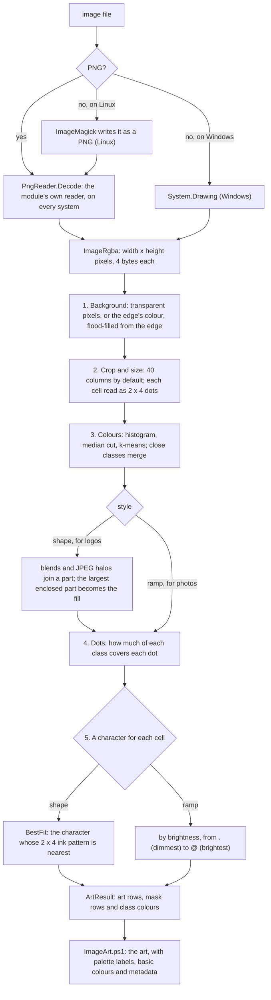

# How New-UsaBannerArt works

For anyone reading or changing the image code. The C# is
`UsaBanner/Private/ImageArt.cs`; `UsaBanner/Private/ImageArt.ps1` is the
PowerShell around it. What the command does for its user is in
[SPEC.md](SPEC.md) §3.9, and why it reads images as it does is in
[DECISIONS.md](DECISIONS.md), D19.

PowerShell makes two calls into the C#:

```powershell
$image  = [UsaBanner.PngReader]::Decode($bytes, 32000000)   # file bytes -> a grid of pixels
$result = [UsaBanner.ArtMaker]::Convert($image, $settings)  # pixels -> characters and colours
```

It is C# for speed: a 1500 x 1500 logo is 2.25 million pixels, each visited
several times. PowerShell loops would take minutes; this takes about half a
second.

## The pipeline



## The five steps

All five are in `ArtMaker.Convert`, in order; the helpers they call follow it
in the file.

| Step | Helpers | What happens |
|---|---|---|
| 1. Background | `BorderColour`, `Flood` | Transparent pixels are background. With none at the edge, a colour that holds half the edge or more is: it is flood-filled from the edge, like the paint-bucket tool, so the same colour inside the picture (Tux's white belly) stays. |
| 2. Crop and size | `RowsFor`, `ColumnsFor` | The art is cut to the picture's box, 40 columns wide by default, and as many rows as keep its shape. A character is about twice as tall as it is wide, so each cell is read as 2 x 4 square dots. |
| 3. Colours | `MedianCut`, `KMeans`, `MergeClose`, `MergeBlends`, `MergeHalos`, `Enclosed`, `Lift` | The colours go into a histogram, median cut picks at most `-Colors` of them, and k-means refines the pick. Classes too close to tell apart merge. In shape style, blends and halos join a part, and the largest part the picture encloses becomes the fill. A colour too dark for a dark terminal is lightened. |
| 4. Dots | `Spans` | Each dot gets its share of each colour class. A dot rarely lines up with whole pixels, so it takes a fraction of the pixels at its edges. |
| 5. Characters | `BestFit`, `Trim` | Shape style picks the character whose ink pattern fits the cell's 8 dots best. Ramp style picks from `.:-=+*#%@` by brightness. Blank edges are trimmed. |

## Three worked examples

**Which character a cell gets** (`BestFit`). Each template is 8 dots, read
left to right and top to bottom: `o` is `00001111`, the bottom half; `d` is
`01011111`. A cell's 8 coverages, each 0 to 1, are compared with every
template, and the smallest total difference wins. A cell on a ring's lower
edge:

```text
cell        template        difference, dot by dot
0   0       'o' 00001111    0 + 0 + 0 + 0.4 + 0.7 + 0 + 0 + 0 = 1.1   <- nearest
0   0.4     'd' 01011111    2.3
0.3 1       ',' 00000010    2.7
1   1
```

**Blend or halo** (`Between`). Colours are points in a cube of red, green
and blue, and a mix of two colours lies on the straight line between them.
`Between` finds how far along the line a colour lies (t, 0 to 1) and how far
off it. JPEG leaves (120,175,250) around a blue (30,111,217) part on white: t
is 0.42, 18 off the line. An anti-aliasing blend lies within 12 of its line,
so this is not one; a JPEG halo may lie within 48, so this can be. A halo
must also touch both the background and the part along a fifth or more of its
pixels.

**A colour's bin** (the histogram in step 3). This line cuts each channel to
32 levels (`r >> 3` is r / 8, rounded down) and packs the three into one
15-bit number, so near-identical colours share a bin:

```csharp
int bin = (r >> 3) << 10 | (g >> 3) << 5 | (b >> 3);
```

## Reading the C# with PowerShell in mind

| C# | PowerShell |
|---|---|
| `public static class ArtMaker` | a module of functions, called as `[UsaBanner.ArtMaker]::Convert(...)` |
| `public sealed class ImageRgba { public readonly int Width; ... }` | a typed `[pscustomobject]` whose constructor checks its inputs; `readonly` is set once |
| `var x = ...` | `$x = ...`, with the type worked out by C# |
| `List<double[]>`, `Dictionary<int, int>` | `[System.Collections.Generic.List[double[]]]`, and a hashtable |
| `c ? a : b` | `if (c) { a } else { b }`, as one expression |
| `(byte)x`, `(int)x` | casts that truncate and wrap: `(byte)300` is 44 |
| `7 / 2`, both whole numbers | 3: integer division drops the fraction |
| `out double t` | a second result, as `[ref]$t` |
| `(a, b) => ...` | a scriptblock handed to a method |
| `using (var z = ...) { }` | `try { } finally { $z.Dispose() }` |
| `throw new FormatException("...")` | `throw`; `ImageArt.ps1` catches it and adds which file |

Bits: `>>` and `<<` are `-shr` and `-shl`. On numbers, a single `|` or `&` is
`-bor` or `-band`, while `||` and `&&` are `-or` and `-and`. A pixel is 4
bytes, R G B A, so the pixel at x, y is number `y * width + x`, and its bytes
start at 4 times that.

## The numbers to tune

Each is a constant at the top of `ArtMaker`, with a one-line comment.

| Constant | Value | What it sets |
|---|---|---|
| `Tolerance` | 40 | how close, in RGB distance, a pixel must be to the background colour to count as background |
| `MergeDistance` | 32 | classes closer than this become one |
| `LiftLuma` | 80 | a colour darker than this luma, of 255, is lightened: black becomes `#505050` |
| `BlendShare`, `BlendDistance` | 3%, 12 | the largest share, and the distance from the line, at which a class counts as a blend between two others |
| `HaloShare`, `HaloContact`, `HaloDistance` | 15%, 20%, 48 | the same for a JPEG halo around a part |
| `PhotoError` | 18 | auto style is ramp when pixels miss their class's colour by more than this, on average |
| `MinBackground` | 2% | auto style is shape only when at least this much of the image is background |

The tests are in `tests/ImageArt.Tests.ps1`. `tests/TestPng.ps1` writes their
PNGs, and is written apart from the reader so a mistake in one does not hide
in the other.
